# Session 1. TOP Design Project (RTL-to-GDSII)

[← 메인으로](../README.md)

> 📅 2026.10 · ⏱ Clock 1.0 ns · 📐 Die 72 × 72 µm · 🧪 SAED 32nm Multi-Vt (HVT / RVT / LVT) · 🧰 VCS / Design Compiler / Formality / IC Compiler II

4-bit Max / Min / Error 연산기(TOP)를 **DC 합성 + Manual ECO**로 합성 단계 위반을 정리한 뒤, **ICC2로 Floorplan부터 Routing, Filler까지** 진행해 최종 Setup / Hold / DRC / LVS / PG 위반 0으로 마무리한 프로젝트입니다.

**목차**
1. [Logic Synthesis & Manual ECO (DC)](#1-logic-synthesis--manual-eco-dc) (Slide 1 ~ 17)
2. [Physical Design (ICC2)](#2-physical-design-icc2) (Slide 18 ~ 39)
   - [Design Setup](#21-design-setup) (19 ~ 22) · [Powerplan](#22-powerplan) (23 ~ 28) · [Placement & CTS](#23-placement--cts) (29 ~ 33) · [Routing & Verification](#24-routing--verification) (34 ~ 39)

### 📌 Key Results

| 항목 | 결과 |
|---|---|
| Synthesis (DC) | max_cap / max_transition 위반 정리, Formality 144 points **Verification SUCCEEDED** |
| Timing (ICC2, SI 포함) | Setup WNS **0.00** / NVE 0 · Hold WNS **+0.04** / NVE 0 |
| CTS | 4-level, Clock buffer 30개, Global Skew **0.02 ns** (목표 0.05) |
| Physical Verification | Routing DRC **0** · Antenna **0** · LVS Open/Short **0 / 0** (761 nets) · PG floating **0** |
| Area | Cell Area 1697.7 → 1766.6 µm² (**+4%**, CTS buffer와 timing 최적화 셀) |
| Trouble Shooting | PG via 미생성(floating 19) 해결 · NDM 재구축으로 Routing DRC 11~13건 → **0** |

---

## 1. Logic Synthesis & Manual ECO (DC)

### Slide 1 · 표지

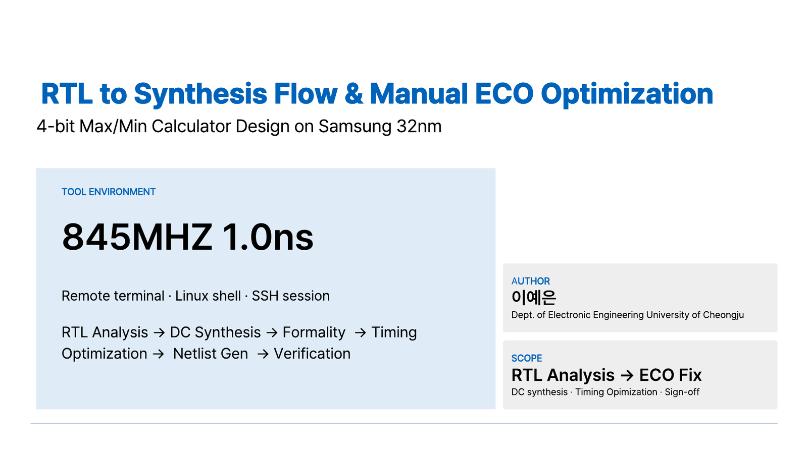

**RTL to Synthesis Flow & Manual ECO Optimization** — 4-bit Max/Min 연산기를 32nm 공정에서 1.0 ns 목표로 합성하고, 남은 위반을 Manual ECO로 정리했습니다.

Flow: RTL Analysis → DC Synthesis → Formality → Timing Optimization → Netlist Gen → Verification

---

### Slide 2 · Design Setup

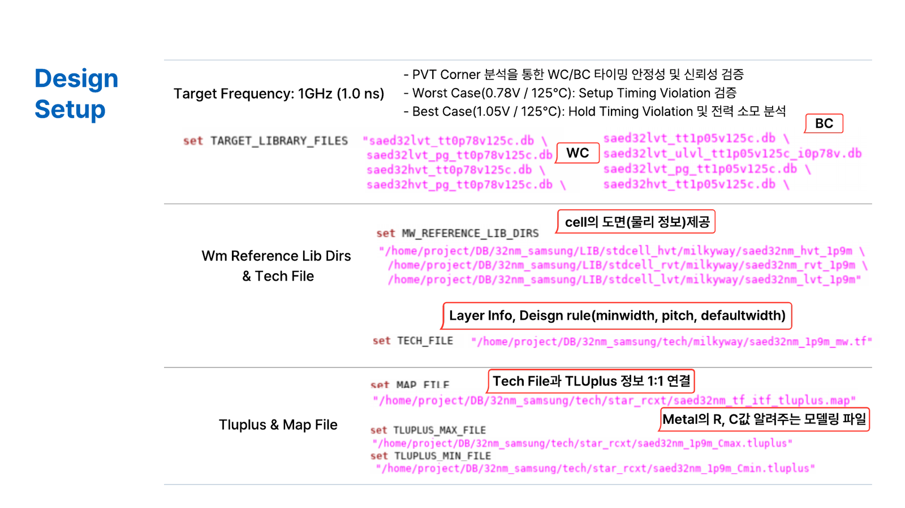

Target clock **1.0 ns**, PVT corner를 나눠 분석했습니다.

- **Worst Case (0.78 V / 125 °C)** — Setup timing 검증
- **Best Case (1.05 V)** — Hold timing 및 전력 분석

| 변수 | 내용 |
|---|---|
| `TARGET_LIBRARY_FILES` | HVT / LVT (+ PG) `.db`를 WC / BC별로 지정 |
| `MW_REFERENCE_LIB_DIRS` | HVT / RVT / LVT milkyway — 셀의 물리 정보 |
| `TECH_FILE` | layer 정보, design rule (min width, pitch) |
| `MAP_FILE` | Tech file과 TLU+ 정보 1:1 연결 |
| `TLUPLUS_MAX / MIN_FILE` | metal R, C 모델링 파일 |

---

### Slide 3 · Design Constraints (SDC)

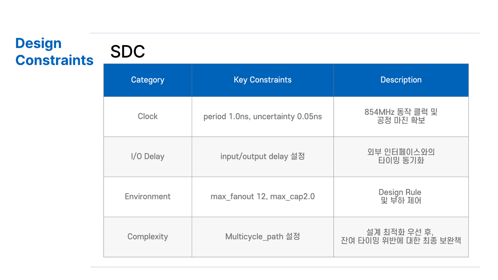

| Category | Key Constraints | 목적 |
|---|---|---|
| Clock | period 1.0 ns, uncertainty 0.05 ns | 동작 클럭과 공정 마진 확보 |
| I/O Delay | input / output delay | 외부 인터페이스와 타이밍 동기화 |
| Environment | max_fanout 12, max_cap 2.0 | Design rule 및 부하 제어 |
| Complexity | multicycle_path | 설계 최적화 후 남은 위반의 최종 보완책 |

---

### Slide 4 · Advanced Timing & Opt

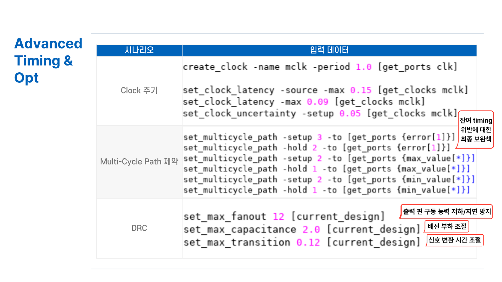

```tcl
create_clock -name mclk -period 1.0 [get_ports clk]
set_clock_latency -source -max 0.15 [get_clocks mclk]
set_clock_latency -max 0.09 [get_clocks mclk]
set_clock_uncertainty -setup 0.05 [get_clocks mclk]

set_multicycle_path -setup 3 -to [get_ports {error[1]}]
set_multicycle_path -hold  2 -to [get_ports {error[1]}]
set_multicycle_path -setup 2 -to [get_ports {max_value[*]}]   ;# min_value도 동일
set_multicycle_path -hold  1 -to [get_ports {max_value[*]}]

set_max_fanout 12 [current_design]        ;# 출력 핀 구동 능력 저하 / 지연 방지
set_max_capacitance 2.0 [current_design]  ;# 배선 부하 조절
set_max_transition 0.12 [current_design]  ;# 신호 변환 시간 조절
```

---

### Slide 5 · Synthesis Strategy (TCL)

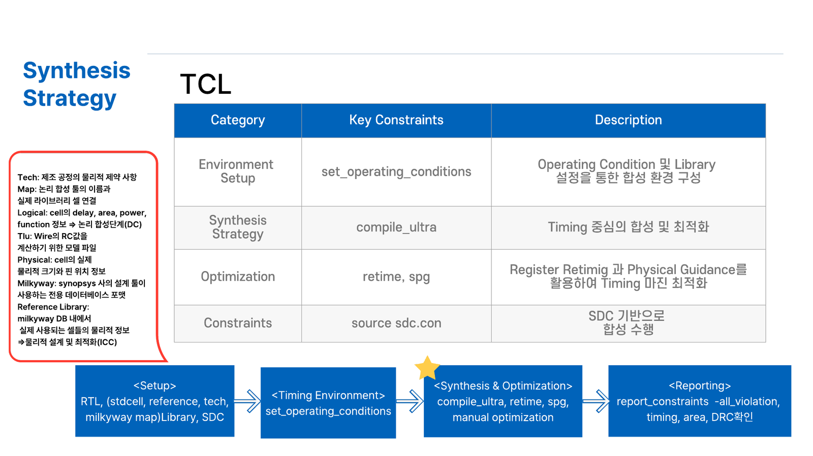

| Category | Key | 설명 |
|---|---|---|
| Environment Setup | `set_operating_conditions` | Operating condition과 library로 합성 환경 구성 |
| Synthesis Strategy | `compile_ultra` | Timing 중심 합성 및 최적화 |
| Optimization | `retime`, `spg` | Register retiming과 physical guidance로 timing 마진 확보 |
| Constraints | `source sdc.con` | SDC 기반 합성 |

**흐름**: Setup (RTL, library, SDC) → Timing Environment → Synthesis & Optimization (`compile_ultra`, retime, spg, manual optimization) → Reporting (`report_constraints -all_violators`, timing, area, DRC)

---

### Slide 6 · Physical Library & Design Env

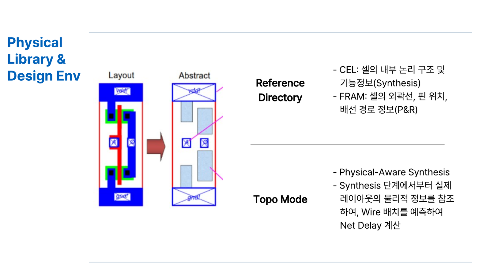

**Reference Directory**
- **CEL** — 셀의 내부 논리 구조와 기능 정보 (Synthesis)
- **FRAM** — 셀 외곽선, 핀 위치, 배선 경로 정보 (P&R)

**Topo Mode** — 합성 단계부터 실제 레이아웃의 물리 정보를 참조해 wire 배치를 예측하고 net delay를 계산하는 Physical-Aware Synthesis

---

### Slide 7 · Multi-Vt 설계

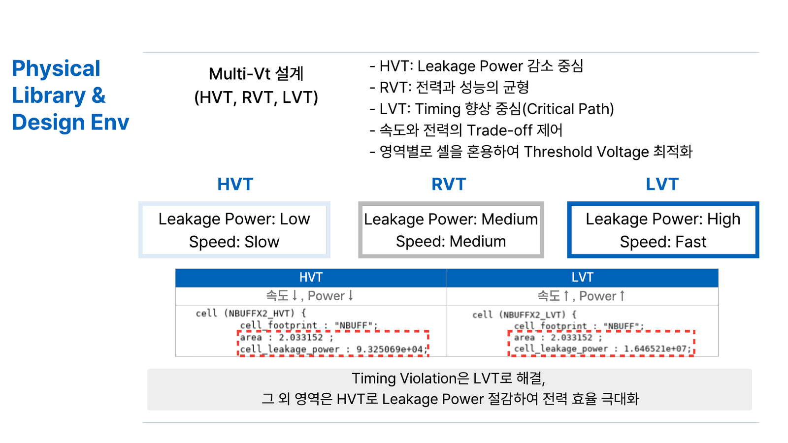

| | HVT | RVT | LVT |
|---|---|---|---|
| Leakage Power | Low | Medium | High |
| Speed | Slow | Medium | Fast |

같은 `NBUFFX2` footprint(area 2.033)에서 leakage가 **HVT 9.33e+04 vs LVT 1.65e+07**로 크게 차이 납니다.
→ **Timing violation은 LVT로 해결하고, 나머지 영역은 HVT로 leakage를 줄이는** 전략을 사용했습니다.

---

### Slide 8 · Functional Verification 시나리오

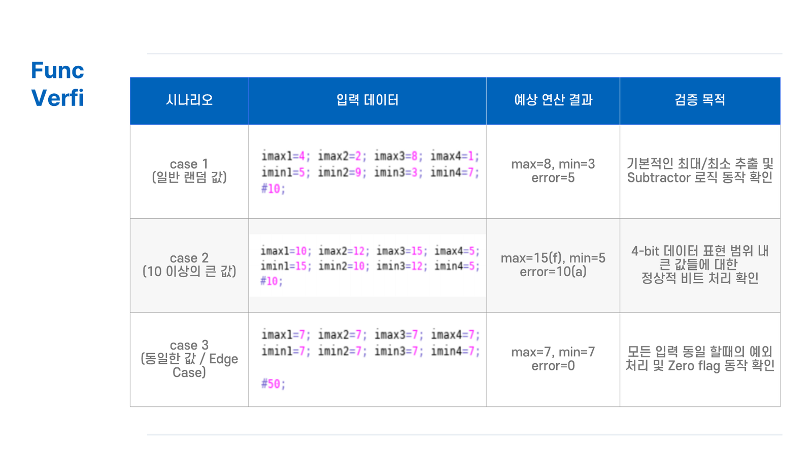

| 시나리오 | 입력 | 예상 결과 | 검증 목적 |
|---|---|---|---|
| case 1 (일반 값) | imax 4,2,8,1 / imin 5,9,3,7 | max 8, min 3, error 5 | 최대/최소 추출과 Subtractor 동작 |
| case 2 (10 이상 큰 값) | imax 10,12,15,5 / imin 15,10,12,5 | max f, min 5, error a | 4-bit 범위 내 큰 값 처리 |
| case 3 (Edge) | 모두 7 | max 7, min 7, error 0 | 동일 입력 예외 처리 |

---

### Slide 9 · Timing Verification

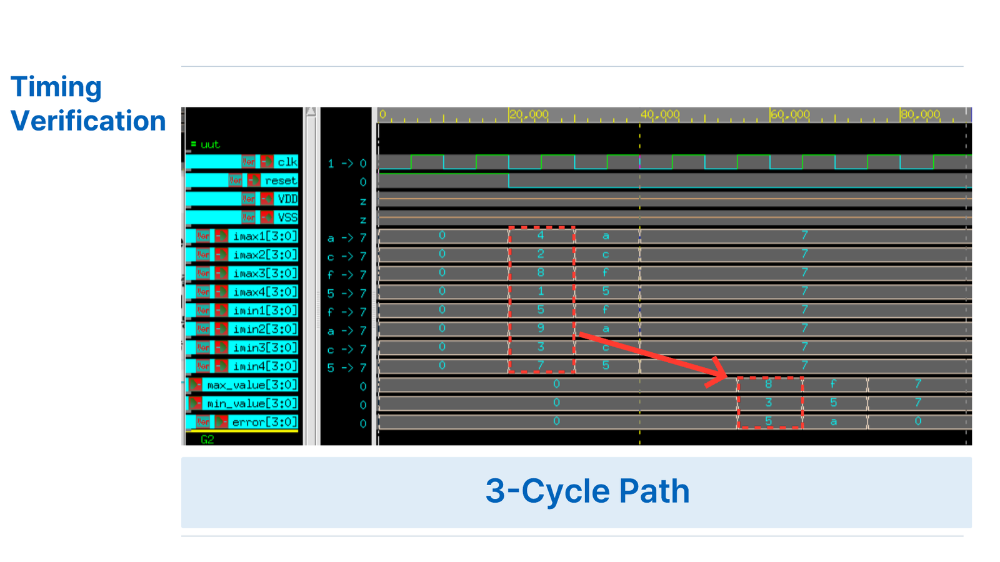

VCS 파형에서 case 1 입력이 들어온 뒤 **3 cycle 후** `max_value / min_value / error`가 8 / 3 / 5로 출력되는 것을 확인했습니다 (3-Cycle Path).

---

### Slide 10 · Synthesis Strategy & Optimization

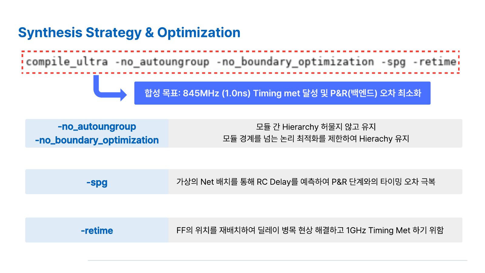

```tcl
compile_ultra -no_autoungroup -no_boundary_optimization -spg -retime
```

| 옵션 | 역할 |
|---|---|
| `-no_autoungroup`, `-no_boundary_optimization` | 모듈 hierarchy를 유지하고 경계를 넘는 최적화 제한 |
| `-spg` | 가상 배치로 RC delay를 예측해 P&R 단계와의 timing 오차 감소 |
| `-retime` | FF 위치를 재배치해 delay 병목 해결 |

---

### Slide 11 · Init Synth Analysis

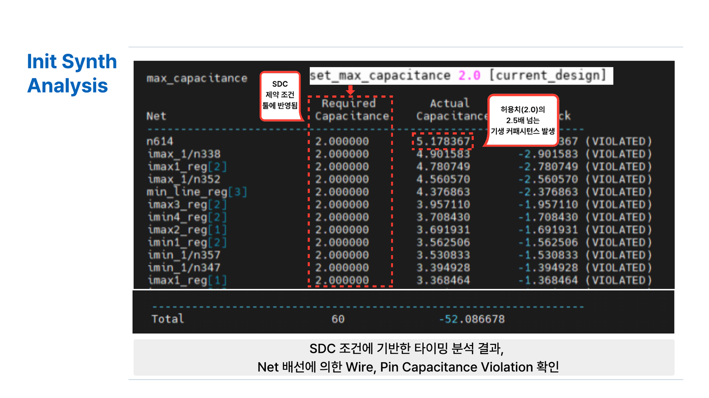

첫 합성 결과 `set_max_capacitance 2.0` 기준으로 **max_capacitance 위반 60건** (총 slack −52.09)이 발생했습니다. 가장 큰 net은 허용치의 약 2.5배(5.18)였습니다. net 배선에 의한 wire / pin capacitance 위반입니다.

---

### Slide 12 · Synth Control & Opt

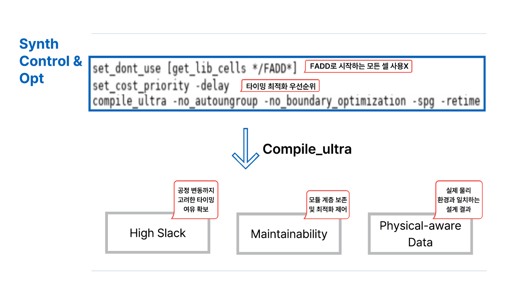

```tcl
set_dont_use [get_lib_cells */FADD*]   ;# FADD로 시작하는 셀 사용 제외
set_cost_priority -delay               ;# timing 최적화 우선
compile_ultra -no_autoungroup -no_boundary_optimization -spg -retime
```

목표: 공정 변동까지 고려한 **timing 여유(High Slack)**, 모듈 계층 보존(Maintainability), 실제 물리 환경과 맞는 **Physical-aware** 결과

---

### Slide 13 · Manual ECO — Buffer Opt

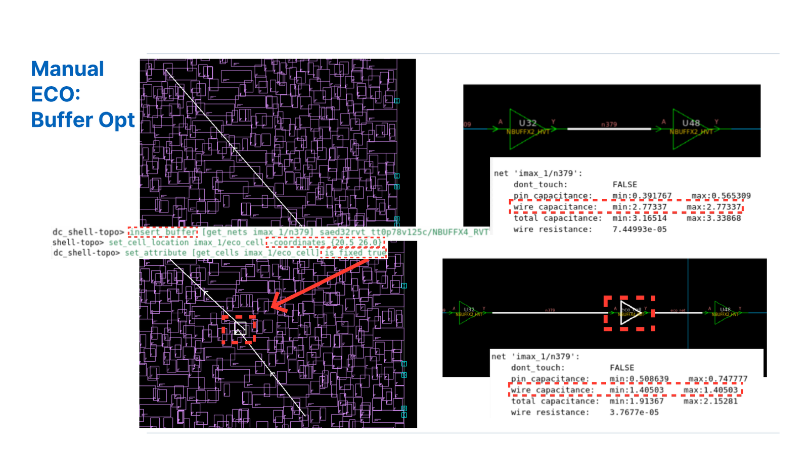

wire capacitance가 큰 net `imax_1/n379`에 buffer를 직접 삽입하고 위치를 고정했습니다.

```tcl
insert_buffer [get_nets imax_1/n379] saed32rvt_tt0p78v125c/NBUFFX4_RVT
set_cell_location imax_1/eco_cell -coordinates {20.5 26.0}
set_attribute [get_cells imax_1/eco_cell] is_fixed true
```

| net `imax_1/n379` | Before | After |
|---|---:|---:|
| wire capacitance | 2.77 | **1.41** |
| total capacitance (max) | 3.34 | **2.15** |

---

### Slide 14 · Manual ECO — Timing Violation & Fix

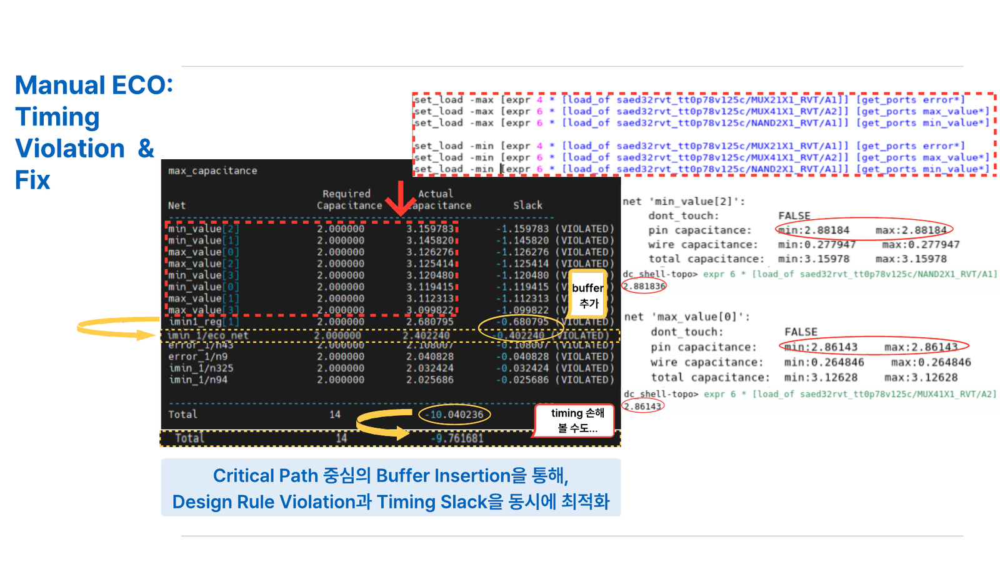

출력 포트에 다음 단 셀(MUX21 / MUX41 / NAND2)의 입력 cap을 기준으로 `set_load`를 설정해 실제 부하를 반영했습니다. 이후 **critical path 중심으로 buffer를 삽입**해 design rule 위반과 timing slack을 함께 줄였습니다 (총 slack −10.04 → −9.76).

---

### Slide 15 · Post-Synth Functional Verification

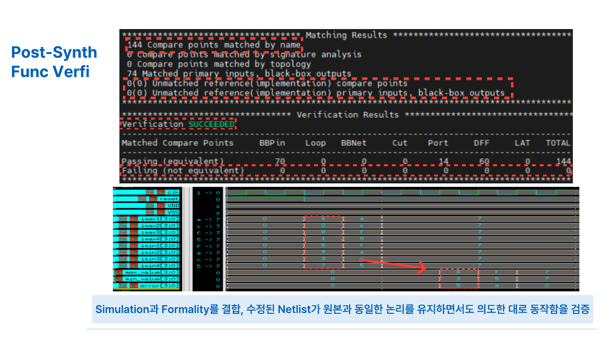

**Formality**: 144 compare points 모두 매칭, Failing 0 → **Verification SUCCEEDED**.
Gate-level 시뮬레이션 파형도 RTL과 같은 결과를 보여, ECO로 수정한 netlist가 원본 논리를 유지하면서 의도대로 동작하는 것을 확인했습니다.

---

### Slide 16 · Process Scaling: 180nm vs 32nm

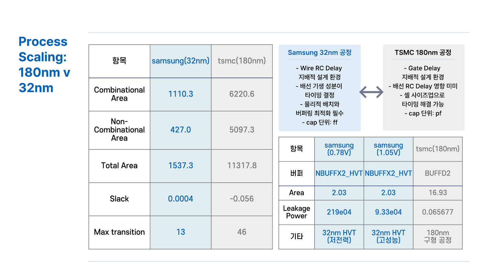

| 항목 | 32nm | TSMC 180nm |
|---|---:|---:|
| Combinational Area | 1110.3 | 6220.6 |
| Non-Combinational Area | 427.0 | 5097.3 |
| Total Area | **1537.3** | 11317.8 |
| Slack | **0.0004** | −0.056 |
| Max transition | 13 | 46 |

- **32nm**: wire RC delay가 timing을 좌우 → 물리 배치와 buffering 최적화가 필수
- **180nm**: gate delay 중심 → 셀 사이즈업으로 timing 해결 가능

---

### Slide 17 · Closing (Synthesis)

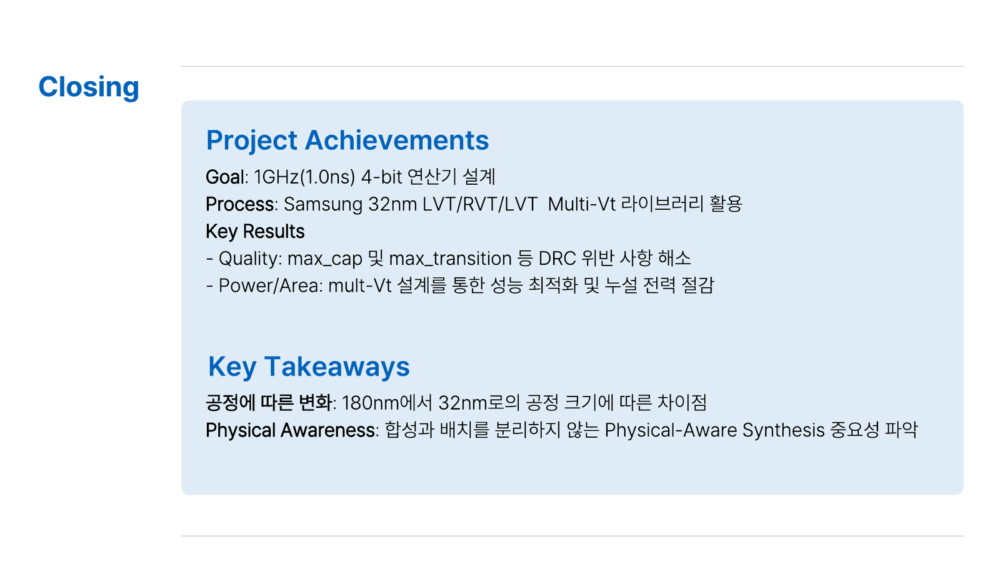

- **Quality**: max_cap, max_transition 등 DRC 위반 해소
- **Power / Area**: Multi-Vt 설계로 성능 확보와 누설 전력 절감
- **Takeaway**: 공정에 따른 차이, 그리고 합성과 배치를 분리하지 않는 Physical-Aware Synthesis의 중요성

---

## 2. Part 2. Physical Design (ICC2)

### Slide 18 · Contents

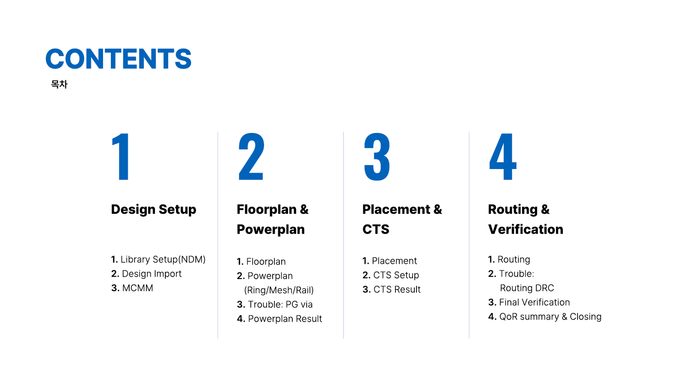

Design Setup → Floorplan & Powerplan → Placement & CTS → Routing & Verification

---

### 2.1 Design Setup

### Slide 19 · Library Setup (NDM)

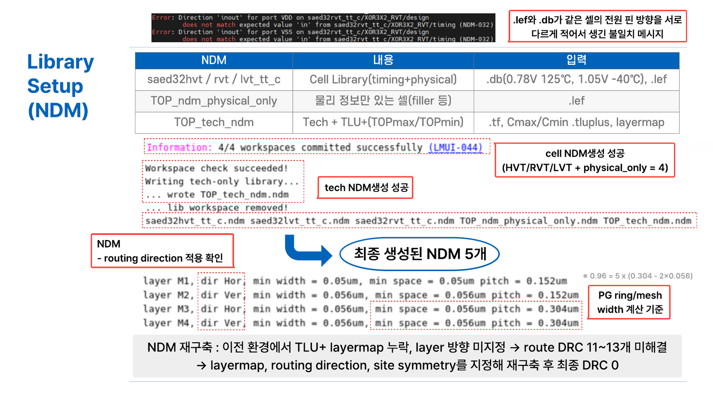

| NDM | 내용 | 입력 |
|---|---|---|
| saed32 hvt / rvt / lvt _tt_c | Cell Library (timing + physical) | `.db`, `.lef` |
| TOP_ndm_physical_only | 물리 정보만 있는 셀 (filler 등) | `.lef` |
| TOP_tech_ndm | Tech + TLU+ | `.tf`, Cmax / Cmin `.tluplus`, layermap |

> 🔧 **NDM 재구축** — 이전 환경에서 TLU+ layermap 누락과 layer 방향 미지정으로 **route DRC 11~13건이 해결되지 않았습니다.** layermap, routing direction, site symmetry를 지정해 NDM을 다시 만든 뒤 최종 **DRC 0**을 달성했습니다 (Slide 36 참고).

---

### Slide 20 · Design Import (nlib)

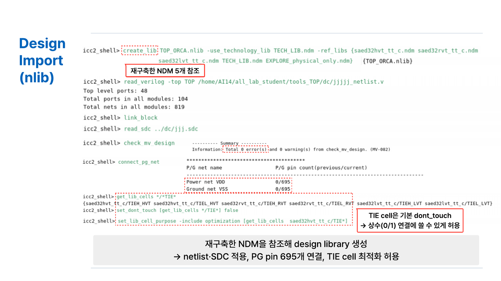

재구축한 NDM 5개로 design library를 만들고 netlist와 SDC를 적용했습니다.

- `read_verilog` → `link_block` → `read_sdc` → `check_mv_design` (error 0)
- `connect_pg_net`으로 PG pin **695개** 연결
- TIE cell은 기본 dont_touch를 풀어 상수(0/1) 연결에 쓸 수 있게 허용

---

### Slide 21 · MCMM

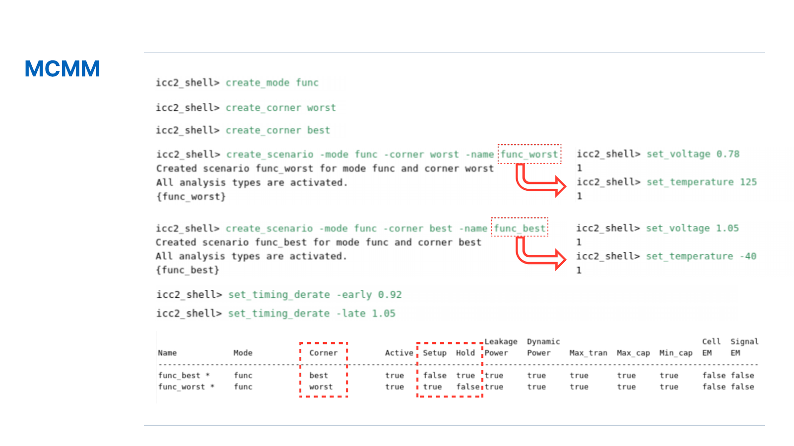

| Scenario | Corner | 조건 | 분석 |
|---|---|---|---|
| func_worst | worst | 0.78 V / 125 °C | **Setup** |
| func_best | best | 1.05 V / −40 °C | **Hold** |

`set_timing_derate -early 0.92 / -late 1.05` 적용.

---

### Slide 22 · Floorplan

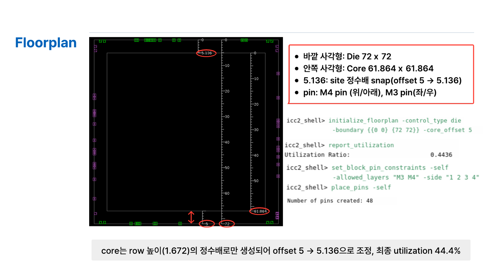

- Die 72 × 72, Core 61.864 × 61.864
- Core는 row 높이(1.672)의 정수배로만 생성되어 offset 5 → **5.136**으로 snap
- Pin: M4 (위/아래), M3 (좌/우), 총 48개
- Utilization **44.4%**

---

### 2.2 Powerplan

### Slide 23 · Powerplan — Ring

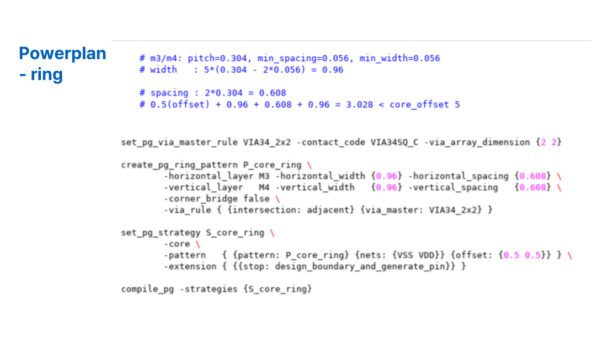

M3 / M4 pitch 0.304, min spacing 0.056을 기준으로 계산했습니다.

| | 계산 | 값 |
|---|---|---|
| Ring width | 5 × (0.304 − 2 × 0.056) | **0.96** |
| Ring spacing | 2 × 0.304 | 0.608 |
| Ring 총폭 | 0.5 + 0.96 + 0.608 + 0.96 = 3.028 | < core offset 5 ✅ |

Ring은 M3(가로) / M4(세로), `VIA34_2x2`로 연결했습니다.

---

### Slide 24 · Powerplan — Mesh

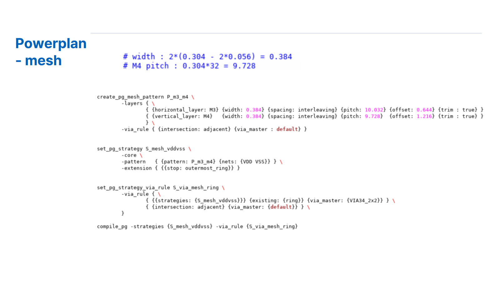

| | 계산 | 값 |
|---|---|---|
| Mesh width | 2 × (0.304 − 2 × 0.056) | **0.384** |
| M4 pitch | 0.304 × 32 | **9.728** |

M3(가로, pitch 10.032) / M4(세로, pitch 9.728) interleaving 패턴으로 생성하고, ring과 만나는 지점은 `VIA34_2x2`로 연결했습니다.

---

### Slide 25 · Powerplan — Rail

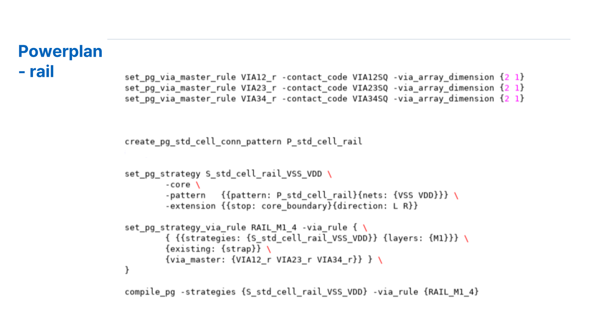

M1 std cell rail을 만들고, `VIA12_r → VIA23_r → VIA34_r` via rule로 M4 strap까지 연결하도록 설정했습니다.

---

### Slide 26 · Trouble: PG via — Issue

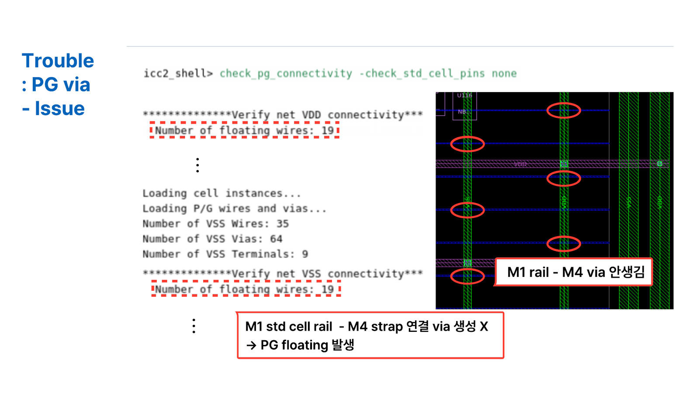

> ⚠️ `check_pg_connectivity` 결과 VDD / VSS 각각 **floating wire 19개**. M1 std cell rail과 M4 strap 사이에 via가 생성되지 않아 PG floating이 발생했습니다.

---

### Slide 27 · Trouble: PG via — Fix

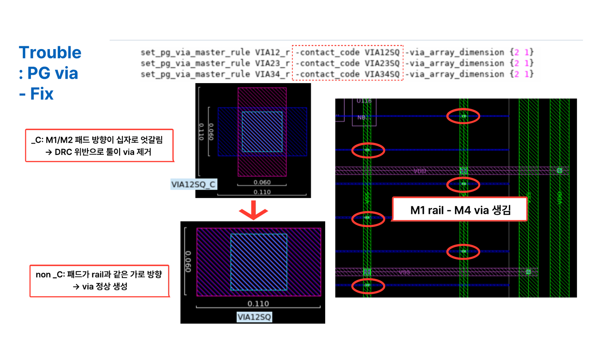

> ✅ `VIA12SQ_C`는 M1 / M2 pad 방향이 십자로 엇갈려 DRC 위반으로 판단되어 툴이 via를 제거하고 있었습니다. pad가 rail과 같은 가로 방향인 **non-_C contact code(`VIA12SQ`)**로 바꾸자 via가 정상 생성되었습니다.

---

### Slide 28 · Powerplan Result

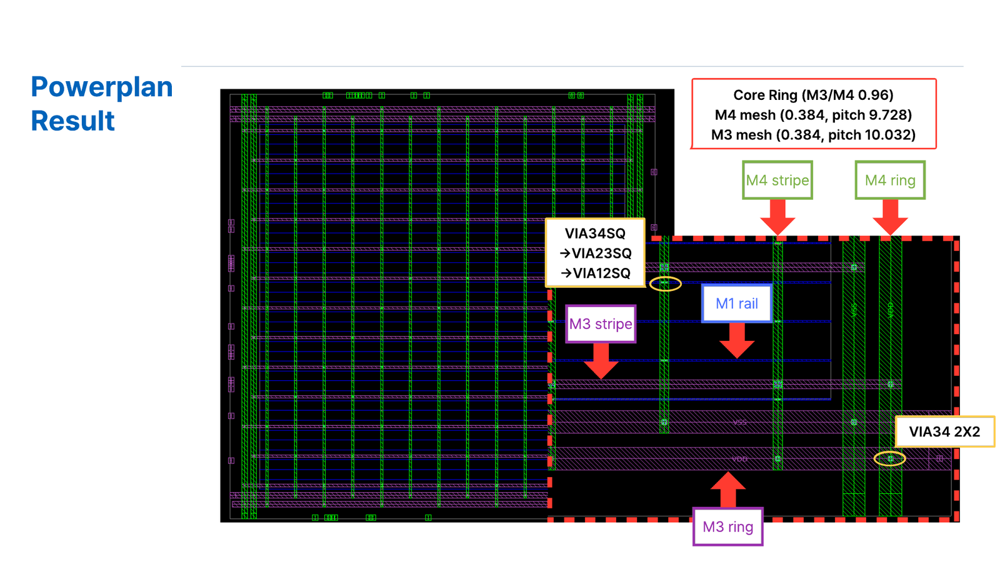

- Core Ring: M3 / M4, width 0.96
- M4 mesh: width 0.384, pitch 9.728
- M3 mesh: width 0.384, pitch 10.032
- M1 rail → VIA12SQ → VIA23SQ → VIA34SQ로 M4까지 연결

---

### 2.3 Placement & CTS

### Slide 29 · Placement — Flow

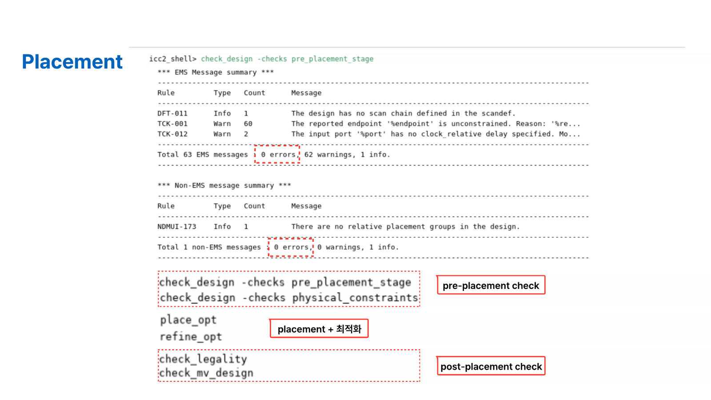

| 단계 | 명령 |
|---|---|
| pre-placement check | `check_design -checks pre_placement_stage`, `physical_constraints` (error 0) |
| placement + 최적화 | `place_opt`, `refine_opt` |
| post-placement check | `check_legality`, `check_mv_design` |

---

### Slide 30 · Placement — Result

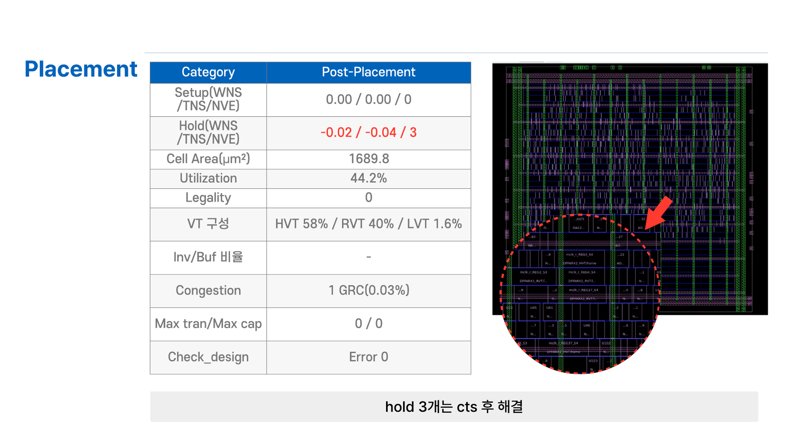

| Category | Post-Placement |
|---|---|
| Setup (WNS / TNS / NVE) | 0.00 / 0.00 / 0 |
| Hold (WNS / TNS / NVE) | −0.02 / −0.04 / 3 → **CTS 후 해결** |
| Cell Area | 1689.8 µm² |
| Utilization | 44.2% |
| Legality | 0 |
| VT 구성 | HVT 58% / RVT 40% / LVT 1.6% |
| Congestion | 1 GRC (0.03%) |
| Max tran / Max cap | 0 / 0 |

---

### Slide 31 · CTS Setup (1)

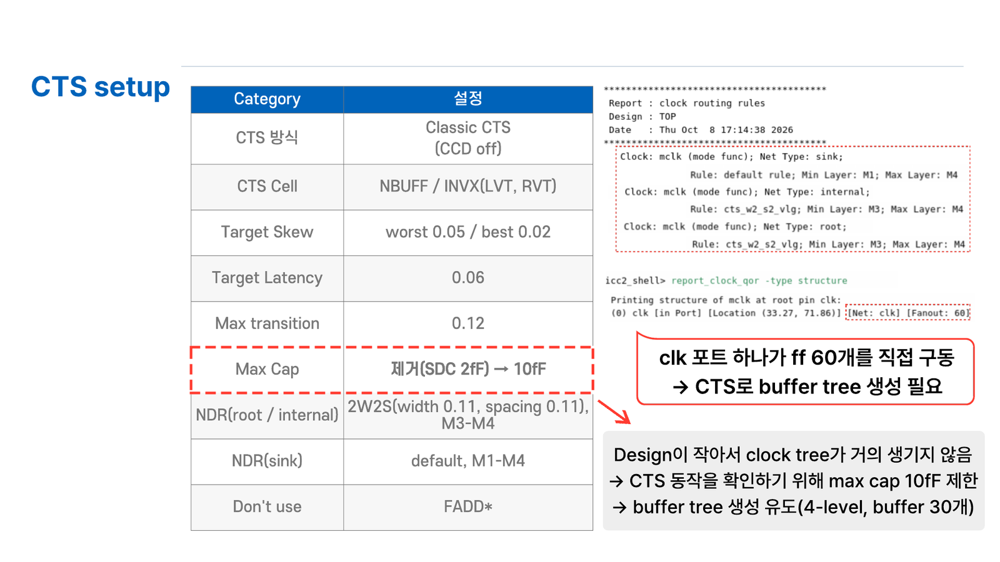

| Category | 설정 |
|---|---|
| CTS 방식 | Classic CTS (CCD off) |
| CTS Cell | NBUFF / INVX (LVT, RVT) |
| Target Skew | worst 0.05 / best 0.02 |
| Target Latency | 0.06 |
| Max transition | 0.12 |
| Max Cap | SDC 2fF 제거 → **10fF** |
| NDR (root / internal) | 2W2S (width 0.11, spacing 0.11), M3-M4 |
| NDR (sink) | default, M1-M4 |
| Don't use | FADD* |

> 💡 clk 포트 하나가 FF 60개를 직접 구동하는데, 설계가 작아 clock tree가 거의 생기지 않았습니다. CTS 동작을 확인하려고 **max cap을 10fF로 제한해 buffer tree 생성을 유도**했습니다 (4-level, buffer 30개).

---

### Slide 32 · CTS Setup (2)

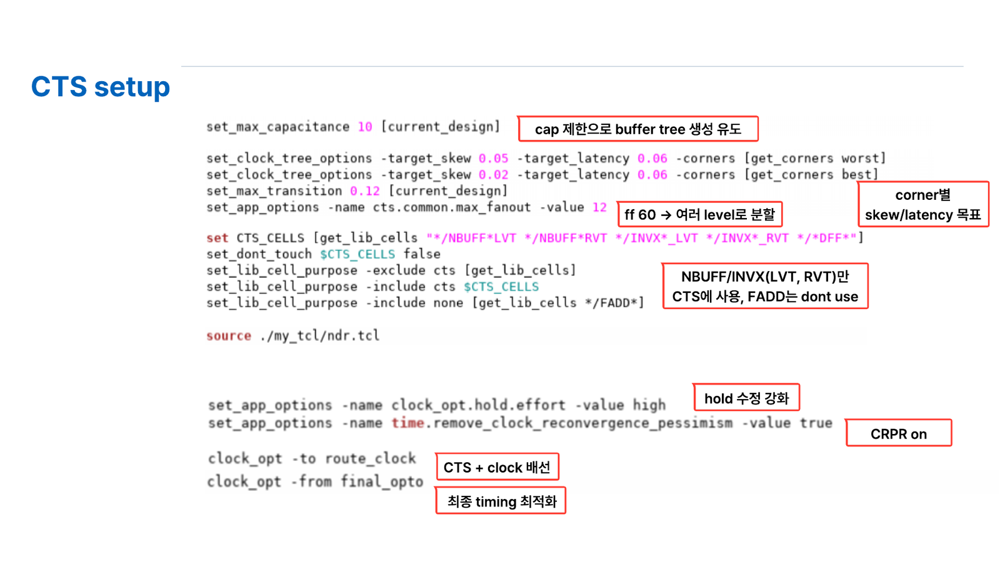

```tcl
set_max_capacitance 10 [current_design]          ;# cap 제한으로 buffer tree 생성 유도
set_clock_tree_options -target_skew 0.05 -target_latency 0.06 -corners [get_corners worst]
set_clock_tree_options -target_skew 0.02 -target_latency 0.06 -corners [get_corners best]
set_app_options -name cts.common.max_fanout -value 12   ;# ff 60 → 여러 level로 분할

set_app_options -name clock_opt.hold.effort -value high                     ;# hold 수정 강화
set_app_options -name time.remove_clock_reconvergence_pessimism -value true ;# CRPR on

clock_opt -to route_clock     ;# CTS + clock 배선
clock_opt -from final_opto    ;# 최종 timing 최적화
```

---

### Slide 33 · CTS Result

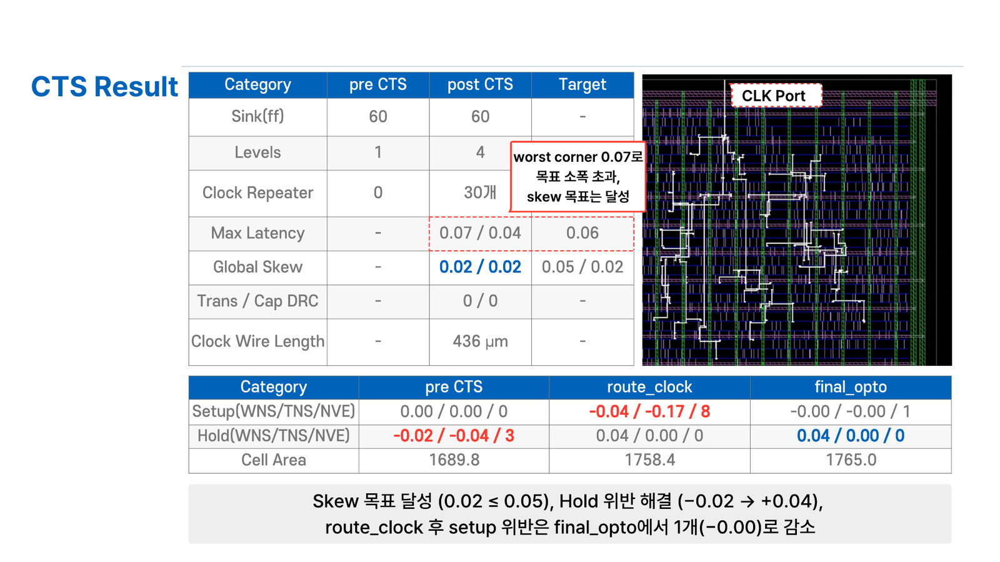

| Category | pre CTS | post CTS | Target |
|---|---|---|---|
| Levels | 1 | 4 | - |
| Clock Repeater | 0 | 30 | - |
| Max Latency (worst / best) | - | 0.07 / 0.04 | 0.06 |
| Global Skew | - | **0.02 / 0.02** | 0.05 / 0.02 |
| Trans / Cap DRC | - | 0 / 0 | - |
| Clock Wire Length | - | 436 µm | - |

| | pre CTS | route_clock | final_opto |
|---|---|---|---|
| Setup (WNS / TNS / NVE) | 0.00 / 0.00 / 0 | −0.04 / −0.17 / 8 | −0.00 / −0.00 / 1 |
| Hold (WNS / TNS / NVE) | −0.02 / −0.04 / 3 | 0.04 / 0.00 / 0 | **0.04 / 0.00 / 0** |

Skew 목표 달성, Hold 위반 해결(−0.02 → +0.04). worst corner latency는 0.07로 목표를 약간 넘었습니다.

---

### 2.4 Routing & Verification

### Slide 34 · Routing — Setting & Result

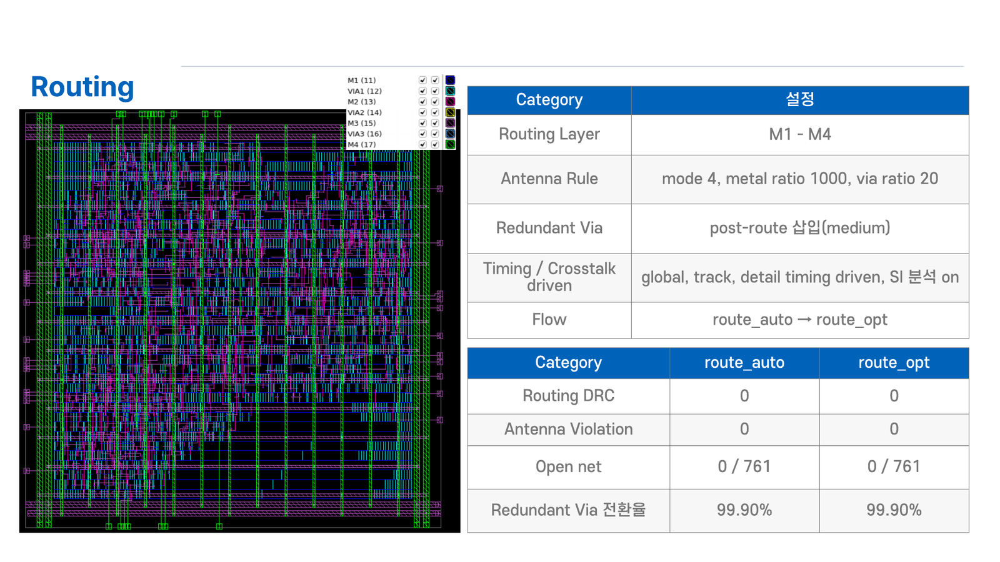

| Category | 설정 |
|---|---|
| Routing Layer | M1 - M4 |
| Antenna Rule | mode 4, metal ratio 1000, via ratio 20 |
| Redundant Via | post-route 삽입 (medium) |
| Timing / Crosstalk | global, track, detail timing driven, SI 분석 on |
| Flow | `route_auto` → `route_opt` |

| Category | route_auto | route_opt |
|---|---|---|
| Routing DRC | 0 | 0 |
| Antenna Violation | 0 | 0 |
| Open net | 0 / 761 | 0 / 761 |
| Redundant Via 전환율 | 99.9% | 99.9% |

---

### Slide 35 · Routing — Script

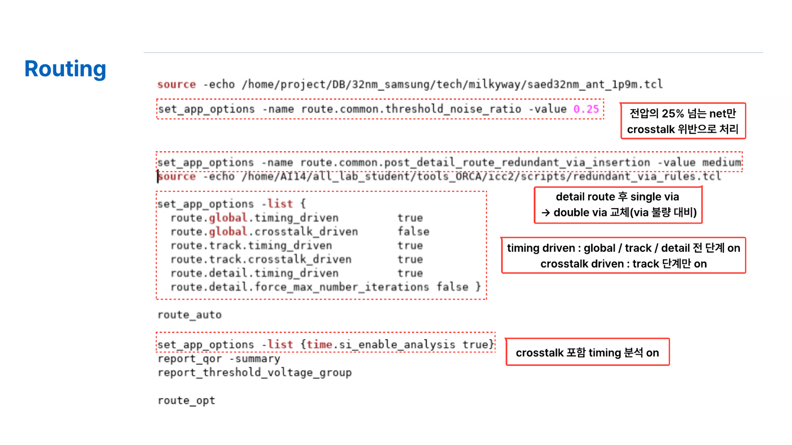

- `route.common.threshold_noise_ratio 0.25` — 전압의 25%를 넘는 net만 crosstalk 위반으로 처리
- `post_detail_route_redundant_via_insertion medium` — detail route 후 single via를 double via로 교체 (via 불량 대비)
- timing driven은 global / track / detail 전 단계, crosstalk driven은 track 단계만 on
- `time.si_enable_analysis true` — crosstalk 포함 timing 분석

---

### Slide 36 · Trouble: Routing DRC — Issue & Fix

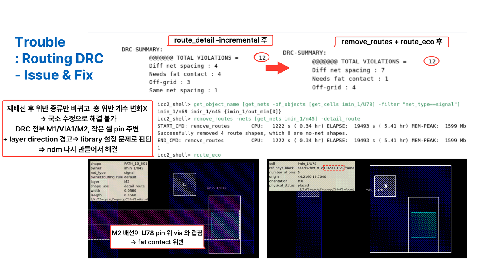

> ⚠️ **Issue** — `route_detail -incremental` 후에도, 해당 net을 `remove_routes` + `route_eco`로 다시 배선한 후에도 **총 위반 12건이 그대로**였고 종류만 바뀌었습니다 (Diff net spacing, Needs fat contact, Off-grid). 예: M2 배선이 U78 pin 위 via와 겹쳐 fat contact 위반.
>
> ✅ **판단과 해결** — 위반이 모두 M1 / VIA1 / M2, 작은 셀 pin 주변에 몰려 있고 layer direction 경고도 함께 있어서, 국소 수정이 아니라 **library 설정 문제**로 판단했습니다. NDM을 다시 만들어 해결했습니다 (Slide 19).

---

### Slide 37 · Final Verification (ICC2)

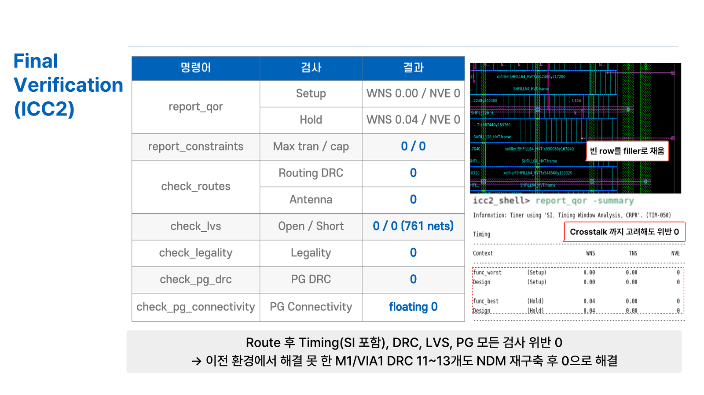

| 명령어 | 검사 | 결과 |
|---|---|---|
| report_qor | Setup / Hold | WNS 0.00 / NVE 0 · WNS 0.04 / NVE 0 |
| report_constraints | Max tran / cap | **0 / 0** |
| check_routes | Routing DRC / Antenna | **0 / 0** |
| check_lvs | Open / Short | **0 / 0** (761 nets) |
| check_legality | Legality | **0** |
| check_pg_drc | PG DRC | **0** |
| check_pg_connectivity | PG Connectivity | **floating 0** |

빈 row는 filler로 채웠고, crosstalk까지 고려해도 위반 0입니다.

---

### Slide 38 · QoR Summary

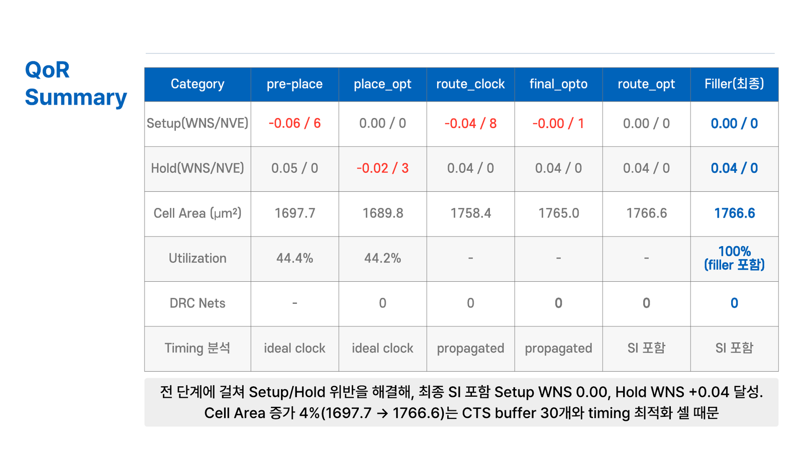

| Category | pre-place | place_opt | route_clock | final_opto | route_opt | **Filler (최종)** |
|---|---|---|---|---|---|---|
| Setup (WNS / NVE) | −0.06 / 6 | 0.00 / 0 | −0.04 / 8 | −0.00 / 1 | 0.00 / 0 | **0.00 / 0** |
| Hold (WNS / NVE) | 0.05 / 0 | −0.02 / 3 | 0.04 / 0 | 0.04 / 0 | 0.04 / 0 | **0.04 / 0** |
| Cell Area (µm²) | 1697.7 | 1689.8 | 1758.4 | 1765.0 | 1766.6 | **1766.6** |
| Utilization | 44.4% | 44.2% | - | - | - | **100% (filler 포함)** |
| DRC Nets | - | 0 | 0 | 0 | 0 | **0** |
| Timing 분석 | ideal | ideal | propagated | propagated | SI 포함 | SI 포함 |

Cell area 4% 증가(1697.7 → 1766.6)는 CTS buffer 30개와 timing 최적화 셀 때문입니다.

---

### Slide 39 · Closing

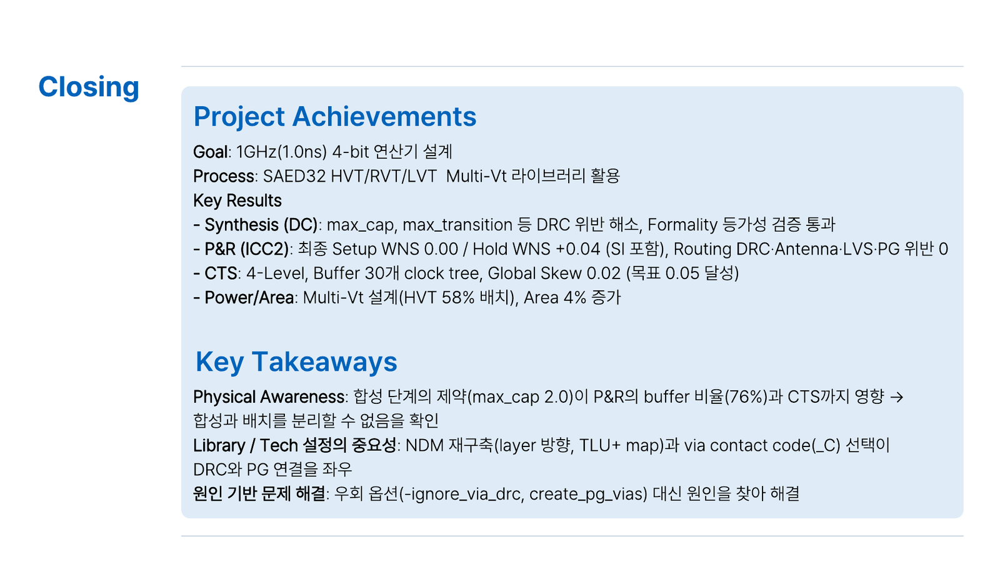

**Key Takeaways**
- **Physical Awareness** — 합성 단계 제약(max_cap 2.0)이 P&R의 buffer 비율(76%)과 CTS까지 영향을 줘서, 합성과 배치를 분리할 수 없다는 것을 확인했습니다.
- **Library / Tech 설정의 중요성** — NDM 재구축(layer 방향, TLU+ map)과 via contact code(_C) 선택이 DRC와 PG 연결을 좌우했습니다.
- **원인 기반 문제 해결** — `-ignore_via_drc`, `create_pg_vias` 같은 우회 옵션 대신 원인을 찾아 해결했습니다.

---

[← 메인으로](../README.md)
