# Session 2. 16-bit RISC Processor (RTL-to-GDSII & Signoff)

[← 메인으로](../README.md)

> ⏱ 500 MHz (2.0 ns) · 🧪 SAED 32nm Multi-Vt (HVT / RVT / LVT) + SRAM1RW64x8 × 2 · 🔁 공정 비교 32 / 130 / 180nm
> 🧰 VCS / Design Compiler / Formality / IC Compiler II / IC Validator / StarRC / PrimeTime (DMSA)

SRAM 매크로 2개를 포함한 16-bit RISC 프로세서를 **RTL 검증 → DC 합성(Manual ECO) → ICC2 PnR → ICV · StarRC · PrimeTime Signoff**까지 진행했습니다. ICC2에서는 clean이었지만 ICV(실제 GDS)에서 나온 **약 340건의 DRC 위반을 runset 분석으로 원인부터 찾아 Detailed 0**으로 만들었고, PT ECO(셀 3개 size 변경)로 **4코너 Setup / Hold 위반 0**을 달성했습니다.

**목차**
1. [Front-end: RTL · Synthesis](#1-front-end) (Slide 3 ~ 32)
2. [Back-end: Floorplan ~ Filler](#2-back-end) (Slide 33 ~ 51)
3. [Signoff & Verification](#3-signoff--verification) (Slide 52 ~ 63)
4. [Overview](#4-overview) (Slide 64 ~ 67)

### 📌 Key Results

| 항목 | 결과 |
|---|---|
| Timing (PT signoff, 4코너 DMSA) | Setup / Hold 위반 **0** · Setup slack **+0.0008 ns** (StarRC SPEF 기준) |
| PT ECO | 셀 **3개** size / VT만 변경, buffer 추가 없음 |
| ICV Signoff DRC | 초기 약 **340건 → Detailed 0** (잔여 126건은 SRAM · 셀 자체 형상 waiver) |
| LVS / Antenna | **0 / 0** |
| Formality | RTL ↔ DC, DC ↔ PnR 모두 **SUCCEEDED** (119 compare points) |
| CTS | Global skew **0.13 ns** (목표 0.3 ns) · sink 83 |
| LVT 비율 | **24.4%** (제약 25% 이내) |
| Gate-level Sim | 최종 PnR netlist **PASS** |

---

### Slide 1 · 표지

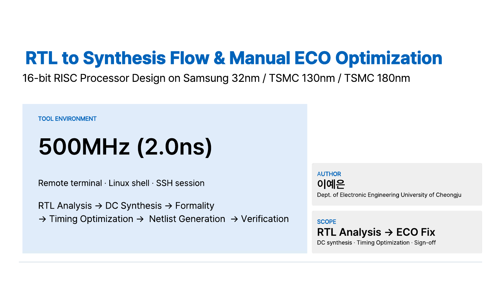

**RTL to Synthesis Flow & Manual ECO Optimization** — 16-bit RISC Processor를 32nm / TSMC 130nm / TSMC 180nm 라이브러리로 설계했습니다. 목표 주파수는 **500 MHz (2.0 ns)**입니다.

---

### Slide 2 · Contents

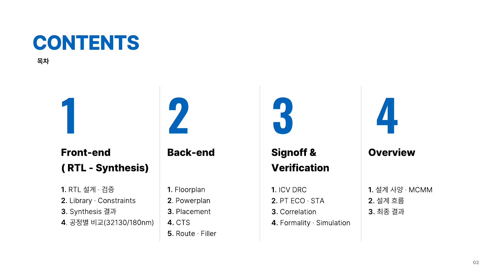

| 1. Front-end | 2. Back-end | 3. Signoff & Verification | 4. Overview |
|---|---|---|---|
| RTL 설계 · 검증 | Floorplan | ICV DRC | 설계 사양 · MCMM |
| Library · Constraints | Powerplan | PT ECO · STA | 설계 흐름 |
| Synthesis 결과 | Placement | Correlation | 최종 결과 |
| 공정별 비교 (32 / 130 / 180nm) | CTS | Formality · Simulation | |
| | Route · Filler | | |

---

## 1. Front-end

### Slide 3 · RTL Design — 모듈 구조

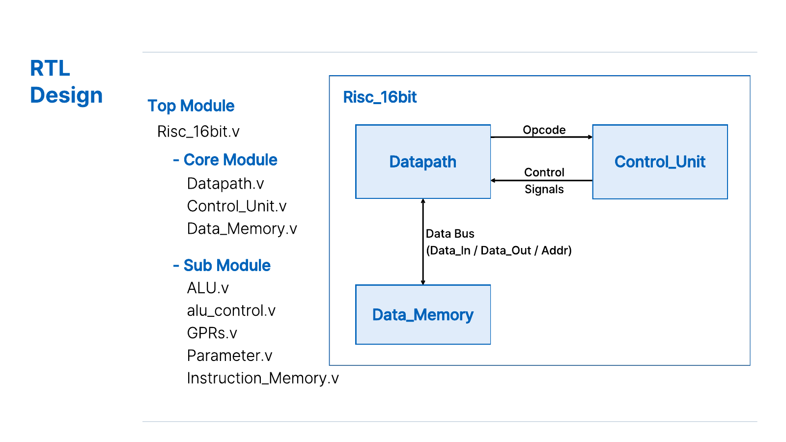

- **Top**: `Risc_16bit.v`
- **Core**: `Datapath.v`, `Control_Unit.v`, `Data_Memory.v`
- **Sub**: `ALU.v`, `alu_control.v`, `GPRs.v`, `Parameter.v`, `Instruction_Memory.v`

Datapath가 Control Unit으로 Opcode를 보내고, Control Unit은 제어 신호를 돌려줍니다. Data Memory와는 Data Bus(Data_In / Data_Out / Addr)로 연결됩니다.

---

### Slide 4 · Datapath — Dataflow

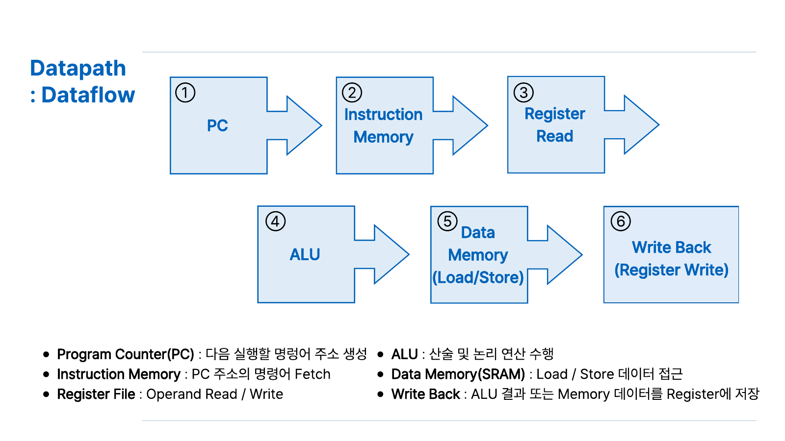

① PC → ② Instruction Memory → ③ Register Read → ④ ALU → ⑤ Data Memory (Load / Store) → ⑥ Write Back

---

### Slide 5 · Datapath — 단계별 코드

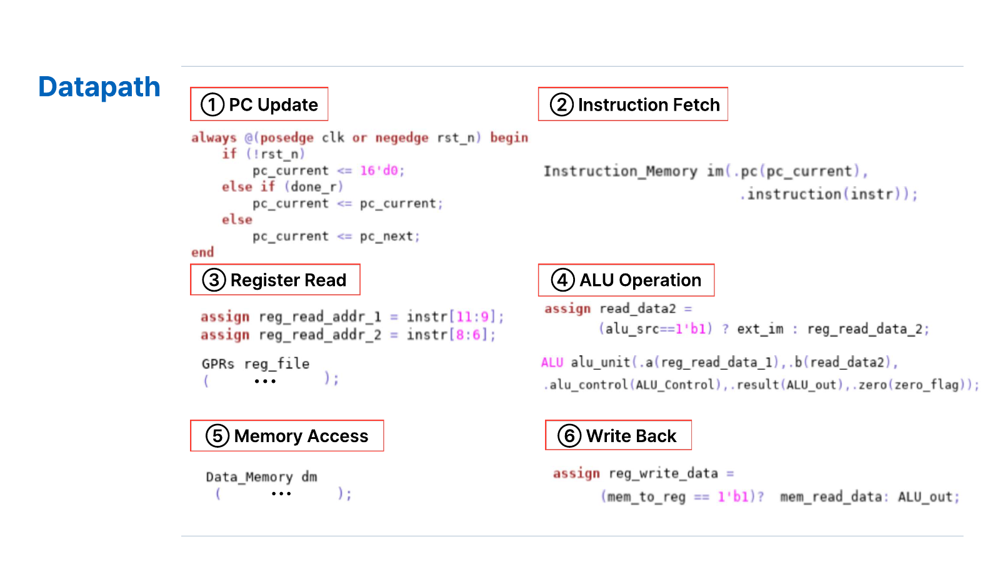

PC Update(`done_r`이면 PC 유지), Instruction Fetch, Register Read(`instr[11:9]`, `instr[8:6]`), ALU Operation(`alu_src`로 즉시값 / 레지스터 선택), Memory Access, Write Back(`mem_to_reg`로 메모리 / ALU 결과 선택)을 각각 RTL로 확인했습니다.

---

### Slide 6 · Control Unit

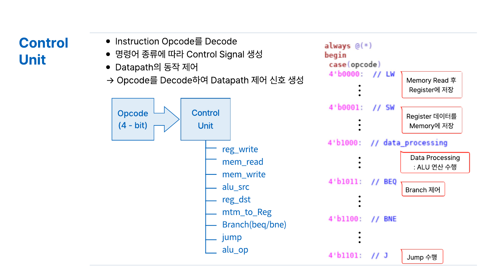

4-bit Opcode를 decode해 Datapath 제어 신호(`reg_write`, `mem_read`, `mem_write`, `alu_src`, `reg_dst`, `mem_to_reg`, `branch`, `jump`, `alu_op`)를 생성합니다.

| Opcode | 명령 | 동작 |
|---|---|---|
| 0000 | LW | Memory Read 후 Register에 저장 |
| 0001 | SW | Register 데이터를 Memory에 저장 |
| 1000 | Data Processing | ALU 연산 |
| 1011 / 1100 | BEQ / BNE | Branch |
| 1101 | J | Jump |

---

### Slide 7 · Data Memory — SRAM

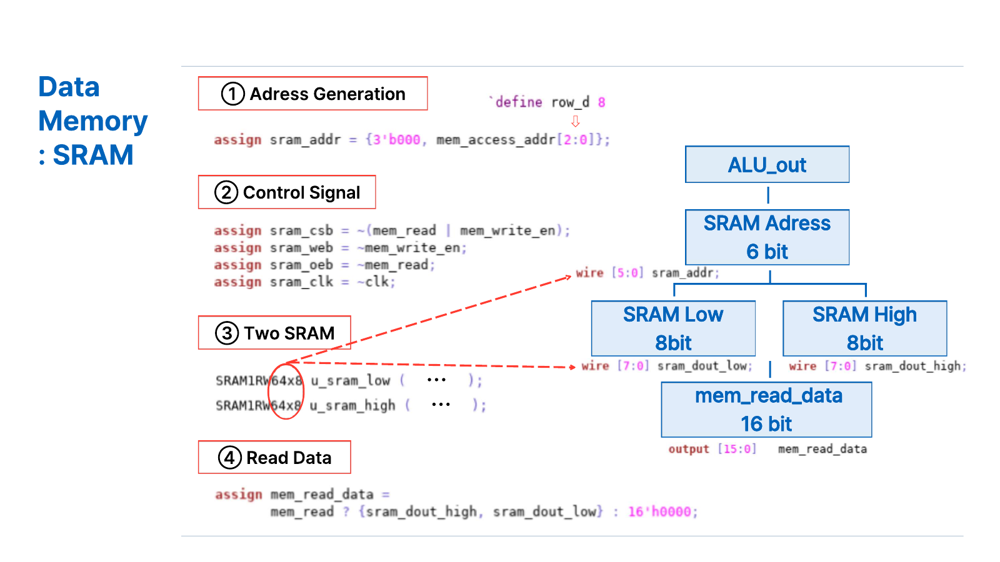

`SRAM1RW64x8` 2개(Low / High 8bit)를 묶어 16bit 데이터 메모리를 구성했습니다.

```verilog
assign sram_addr = {3'b000, mem_access_addr[2:0]};   // 6-bit SRAM address
assign sram_csb = ~(mem_read | mem_write_en);
assign sram_web = ~mem_write_en;
assign sram_oeb = ~mem_read;
assign sram_clk = ~clk;                                // 반전 클럭
assign mem_read_data = mem_read ? {sram_dout_high, sram_dout_low} : 16'h0000;
```

---

### Slide 8 · Testbench

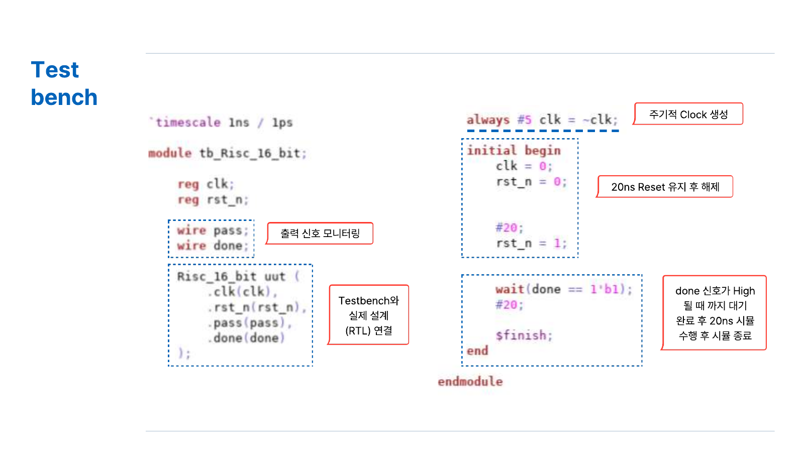

`always #5 clk = ~clk`로 클럭을 만들고, 20 ns 동안 reset을 유지한 뒤 해제합니다. `done`이 High가 될 때까지 기다린 후 20 ns 더 시뮬레이션하고 종료합니다. `pass` / `done`으로 결과를 모니터링합니다.

---

### Slide 9 · Simulation — RTL

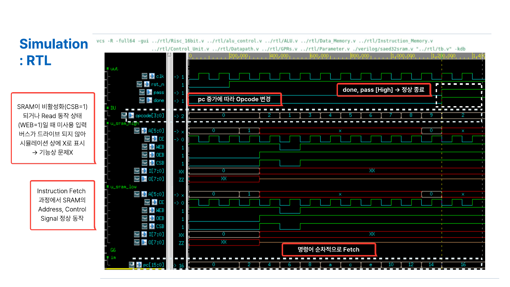

PC가 증가하면서 Opcode가 순서대로 바뀌고, 명령어가 순차적으로 Fetch되며, 마지막에 **done / pass가 High**로 정상 종료됩니다.
SRAM이 비활성(CSB=1)이거나 Read 상태(WEB=1)일 때 쓰지 않는 입력 버스가 X로 표시되지만, 기능상 문제는 없습니다.

---

### Slide 10 · Design Setup

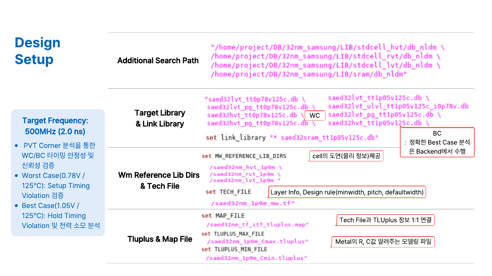

- **Worst Case (0.78 V / 125 °C)** — Setup timing 검증
- **Best Case (1.05 V)** — Hold timing 및 전력 분석 (정확한 Best Case 분석은 Backend에서 수행)
- Target / Link library: HVT / LVT (+ PG) `.db`, `link_library`에 SRAM `.db` 포함
- `MW_REFERENCE_LIB_DIRS`(셀 물리 정보), `TECH_FILE`(layer, design rule), `MAP_FILE`, `TLUPLUS_MAX / MIN_FILE`(metal R, C 모델)

---

### Slide 11 · Physical Library & Design Env

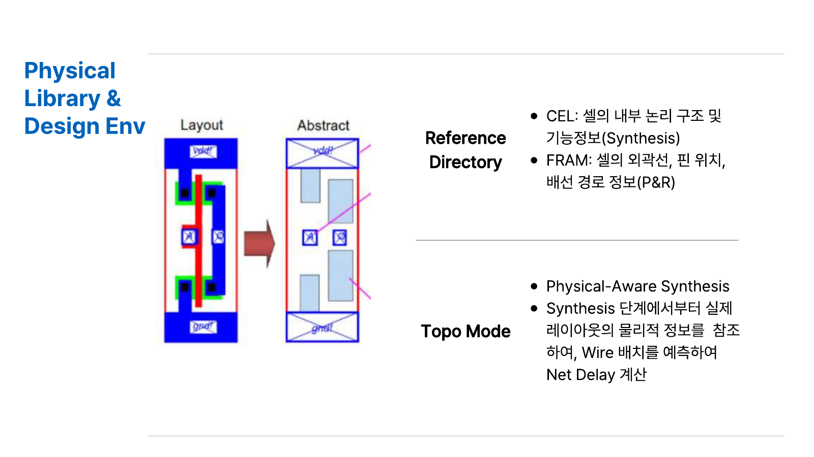

- **CEL** — 셀 내부 논리 구조와 기능 정보 (Synthesis)
- **FRAM** — 셀 외곽선, 핀 위치, 배선 경로 정보 (P&R)
- **Topo Mode** — 합성 단계부터 실제 레이아웃 정보를 참조해 wire를 예측하고 net delay를 계산 (Physical-Aware Synthesis)

---

### Slide 12 · Multi-Vt 설계

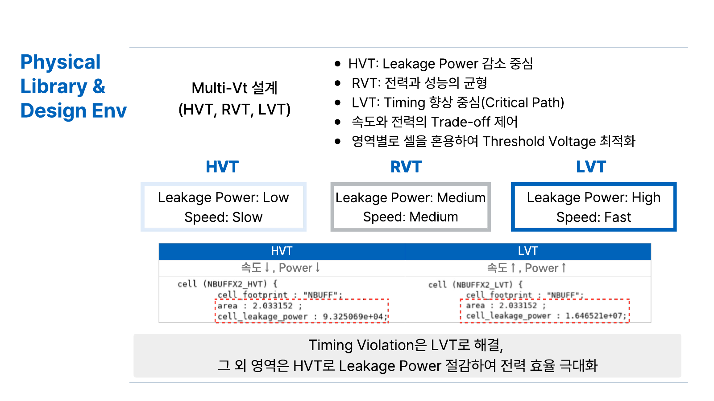

| | HVT | RVT | LVT |
|---|---|---|---|
| Leakage | Low | Medium | High |
| Speed | Slow | Medium | Fast |

`NBUFFX2` 기준 area는 같고(2.033), leakage는 **HVT 9.33e+04 vs LVT 1.65e+07**입니다.
→ Timing violation은 LVT로 해결하고, 나머지는 HVT로 leakage를 줄였습니다.

---

### Slide 13 · Design Constraints

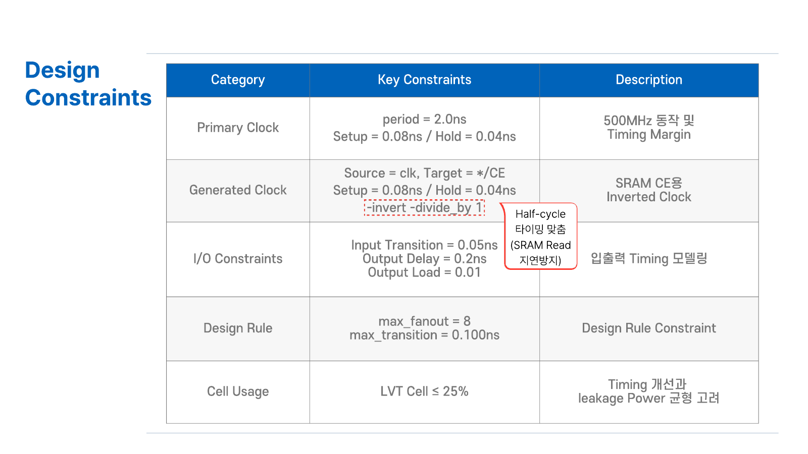

| Category | Key Constraints | 목적 |
|---|---|---|
| Primary Clock | period 2.0 ns, uncertainty setup 0.08 / hold 0.04 | 500 MHz 동작과 timing margin |
| Generated Clock | source clk → `*/CE`, `-invert -divide_by 1` | SRAM CE용 반전 클럭 (half-cycle timing) |
| I/O | input transition 0.05, output delay 0.2, output load 0.01 | 입출력 timing 모델링 |
| Design Rule | max_fanout 8, max_transition 0.100 | DRC |
| Cell Usage | **LVT ≤ 25%** | timing 개선과 leakage 균형 |

---

### Slide 14 · Synthesis TCL

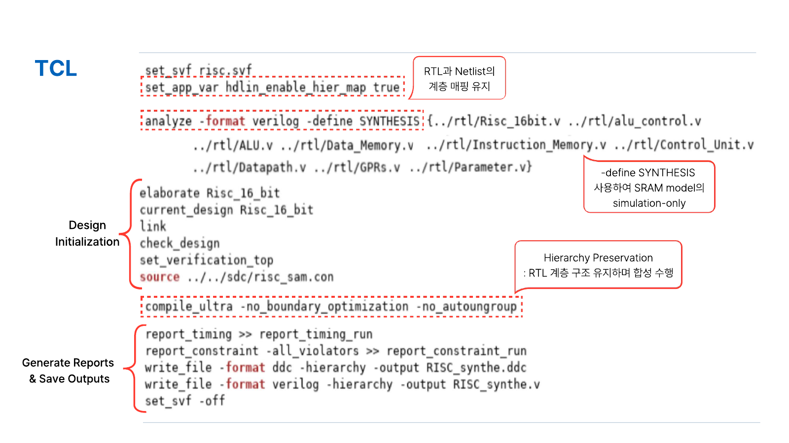

```tcl
set_svf risc.svf
set_app_var hdlin_enable_hier_map true            ;# RTL ↔ Netlist 계층 매핑 유지
analyze -format verilog -define SYNTHESIS {...}   ;# SRAM model은 simulation-only
elaborate Risc_16_bit ; link ; check_design
source ../../sdc/risc_sam.con
compile_ultra -no_boundary_optimization -no_autoungroup   ;# 계층 구조 유지
write_file -format ddc     -hierarchy -output RISC_synthe.ddc
write_file -format verilog -hierarchy -output RISC_synthe.v
```

---

### Slide 15 · Compile — check_design / check_timing

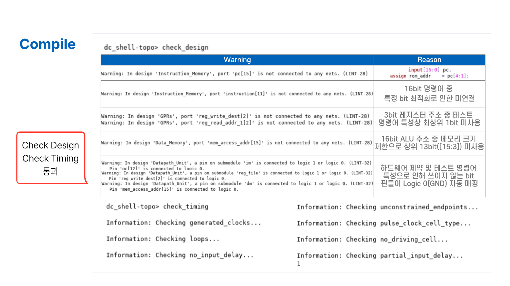

`check_design`의 LINT-28 / LINT-32 warning을 RTL과 대조해 원인을 정리했습니다. (예: `rom_addr = pc[4:1]`이라 `pc[15]` 미사용, 3bit 레지스터 주소 중 최상위 1bit 미사용, 메모리 크기 제한으로 주소 상위 비트 미사용) `check_timing`은 통과했습니다.

---

### Slide 16 · Compile — 초기 결과

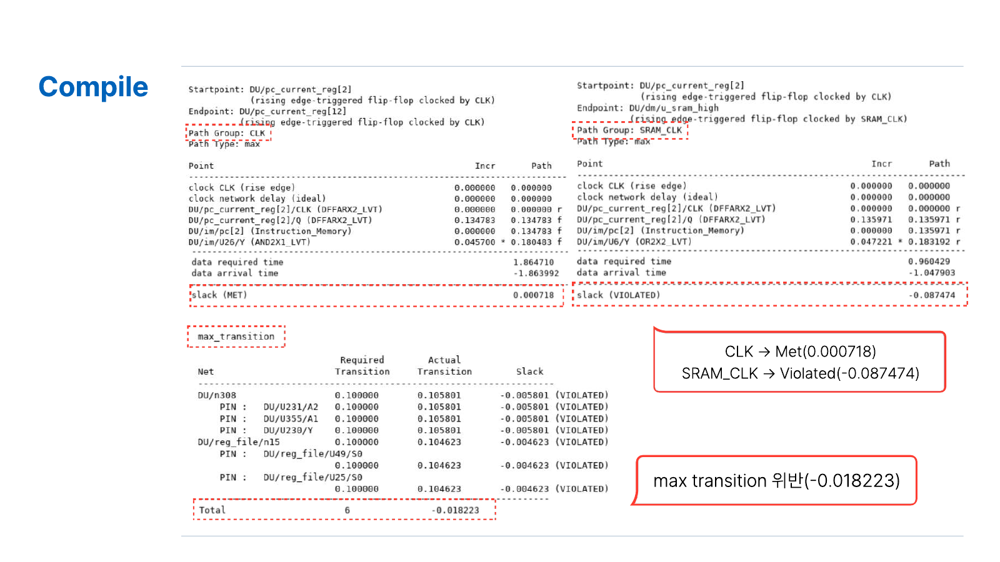

| Path Group | Slack |
|---|---|
| CLK | **MET** (+0.000718) |
| SRAM_CLK | **VIOLATED** (−0.087474) |
| max_transition | 6건, total −0.018223 |

---

### Slide 17 · Warning & Error

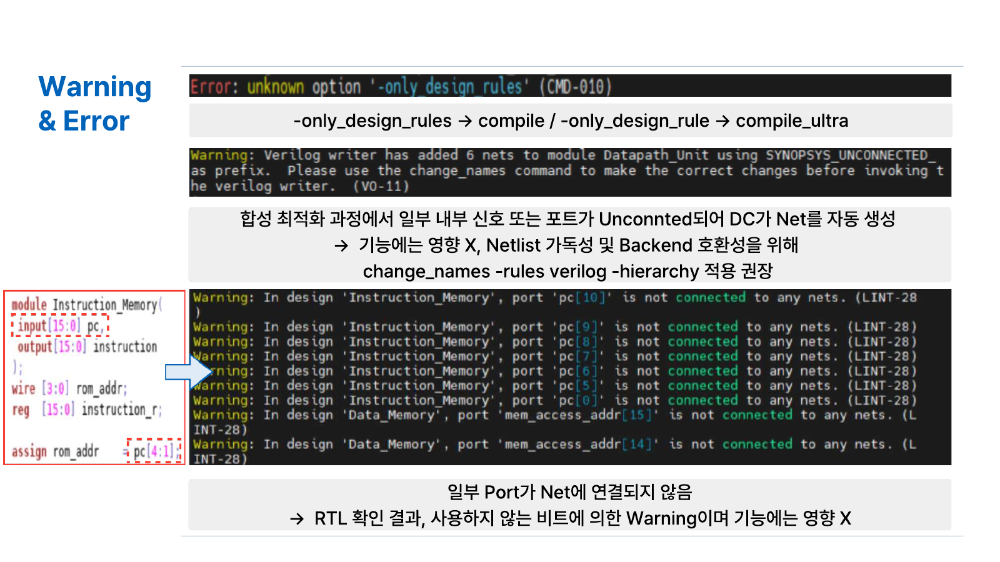

- `-only_design_rules`는 `compile`용이고 `compile_ultra`는 `-only_design_rule` → 옵션 이름 수정
- VO-11: 합성 중 끊긴 net에 DC가 `SYNOPSYS_UNCONNECTED` net을 자동 생성 → 기능 영향 없음, `change_names -rules verilog -hierarchy` 권장
- LINT-28: RTL 확인 결과 사용하지 않는 비트에 의한 warning → 기능 영향 없음

---

### Slide 18 · Modify TCL

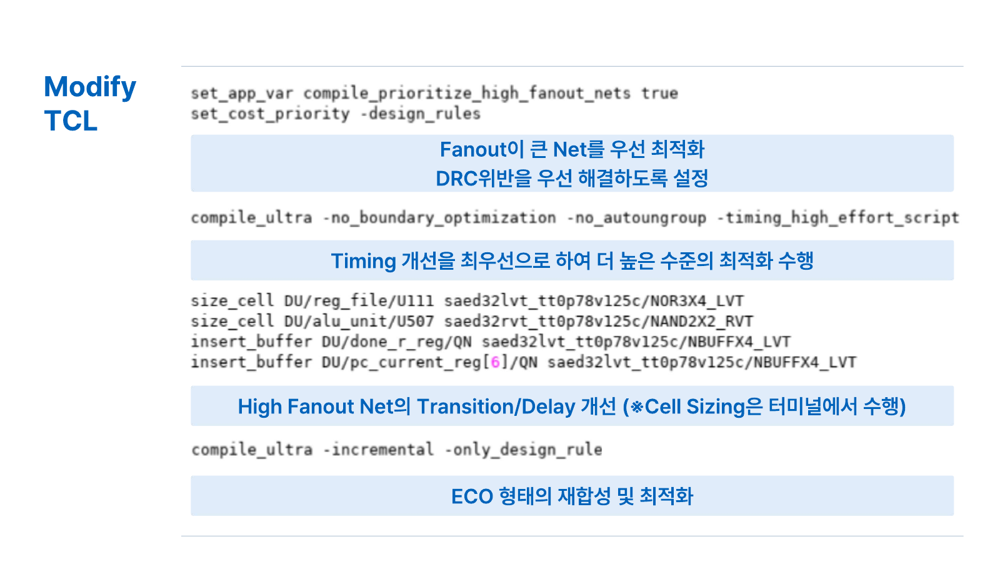

```tcl
set_app_var compile_prioritize_high_fanout_nets true
set_cost_priority -design_rules                    ;# DRC 우선 해결
compile_ultra -no_boundary_optimization -no_autoungroup -timing_high_effort_script
size_cell     DU/reg_file/U111   saed32lvt_tt0p78v125c/NOR3X4_LVT
size_cell     DU/alu_unit/U507   saed32rvt_tt0p78v125c/NAND2X2_RVT
insert_buffer DU/done_r_reg/QN   saed32lvt_tt0p78v125c/NBUFFX4_LVT
insert_buffer DU/pc_current_reg[6]/QN saed32lvt_tt0p78v125c/NBUFFX4_LVT
compile_ultra -incremental -only_design_rule       ;# ECO 형태 재합성
```

---

### Slide 19 · Optimization — DRC

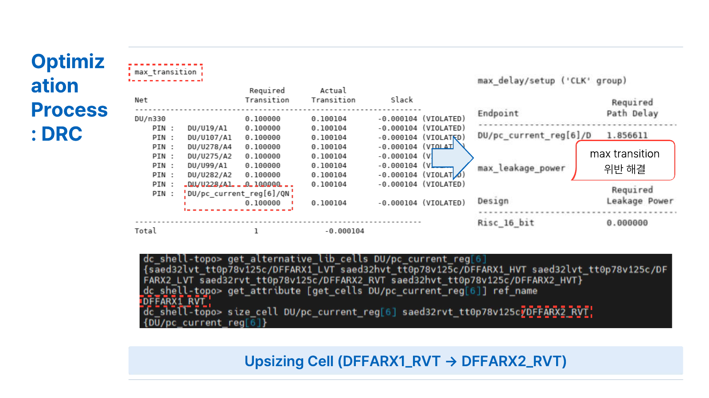

`pc_current_reg[6]/QN`에서 max_transition −0.000104 위반 → `get_alternative_lib_cells`로 후보를 확인하고 **DFFARX1_RVT → DFFARX2_RVT**로 upsizing해 해결했습니다.

---

### Slide 20 · Optimization — Timing

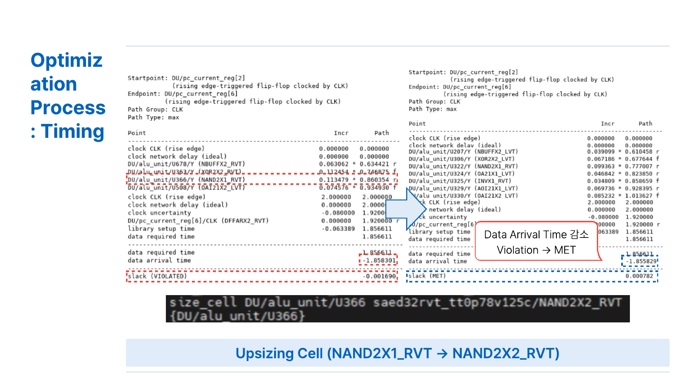

`pc_current_reg[2] → pc_current_reg[6]` 경로 slack −0.001690 → critical path 위의 `alu_unit/U366`을 **NAND2X1_RVT → NAND2X2_RVT**로 upsizing해 **+0.000782 (MET)**.

---

### Slide 21 · Report QoR — Timing / DRC

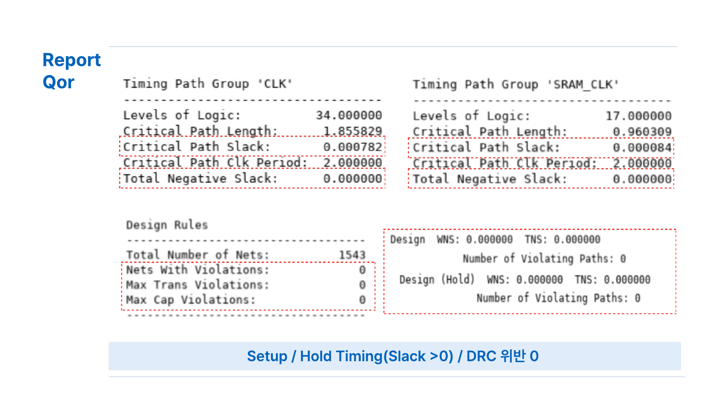

| | CLK | SRAM_CLK |
|---|---|---|
| Levels of Logic | 34 | 17 |
| Critical Path Slack | **+0.000782** | **+0.000084** |
| TNS | 0 | 0 |

Design Rules: nets with violations **0** (max trans 0, max cap 0) · Setup / Hold 위반 경로 0

---

### Slide 22 · Report QoR — Area / VT

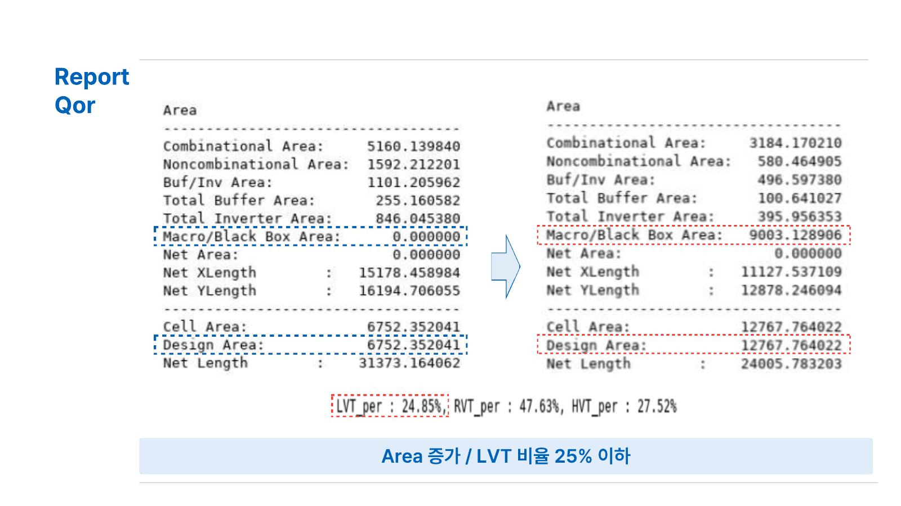

Design Area 6752 → **12767.76** (SRAM macro 9003.13 포함) · **LVT 24.85%** / RVT 47.63% / HVT 27.52% → LVT 25% 이하 만족

---

### Slide 23 · Formality Script

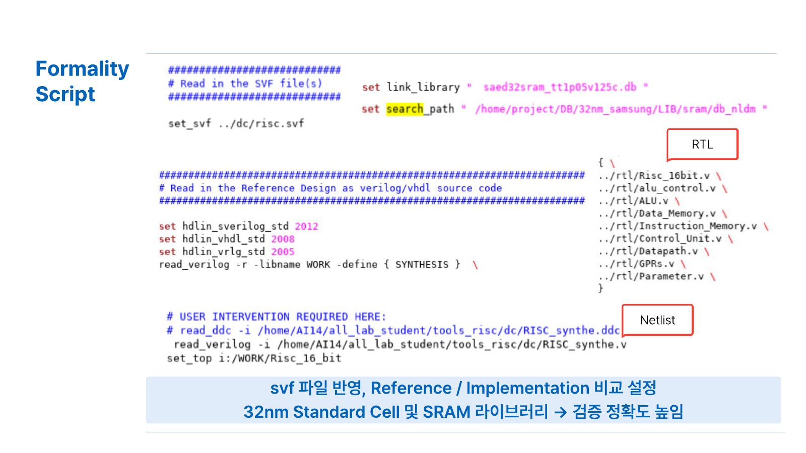

SVF 파일을 반영하고, RTL(reference)과 합성 netlist(implementation)를 비교하도록 설정했습니다. 32nm standard cell과 SRAM 라이브러리를 함께 읽어 검증 정확도를 높였습니다.

---

### Slide 24 · Formality — RTL ↔ DC

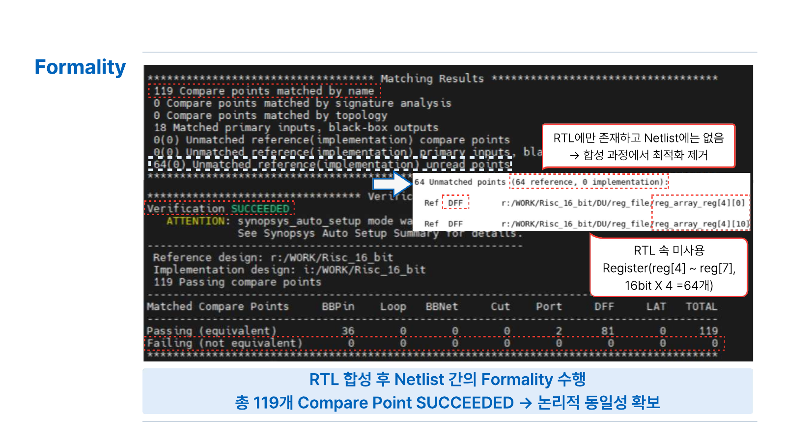

**119 compare points 모두 Passing, Failing 0 → Verification SUCCEEDED**
Unmatched 64개는 RTL에서 쓰지 않는 레지스터(reg[4] ~ reg[7], 16bit × 4)가 합성에서 최적화로 제거된 것입니다.

---

### Slide 25 · VCS Simulation Commands

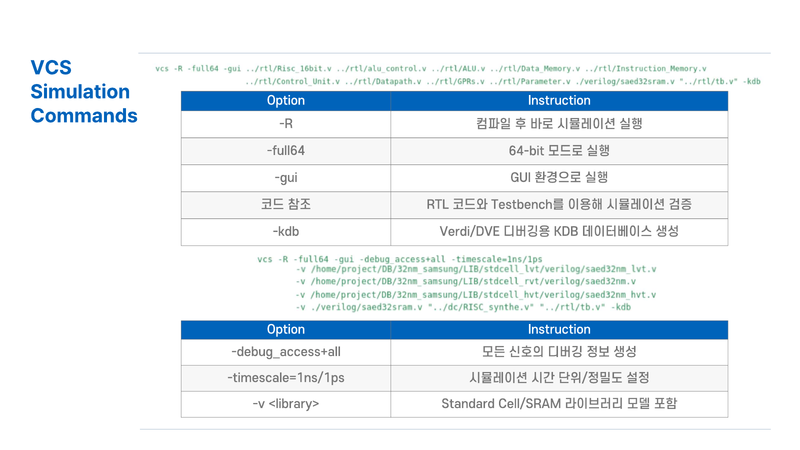

| Option | 설명 |
|---|---|
| `-R` | 컴파일 후 바로 시뮬레이션 |
| `-full64` | 64-bit 모드 |
| `-gui` | GUI 실행 |
| `-kdb` | Verdi / DVE 디버깅용 KDB 생성 |
| `-debug_access+all` | 모든 신호 디버깅 정보 |
| `-timescale=1ns/1ps` | 시간 단위 / 정밀도 |
| `-v <library>` | Standard cell / SRAM 모델 포함 (netlist sim) |

---

### Slide 26 · Simulation — Netlist

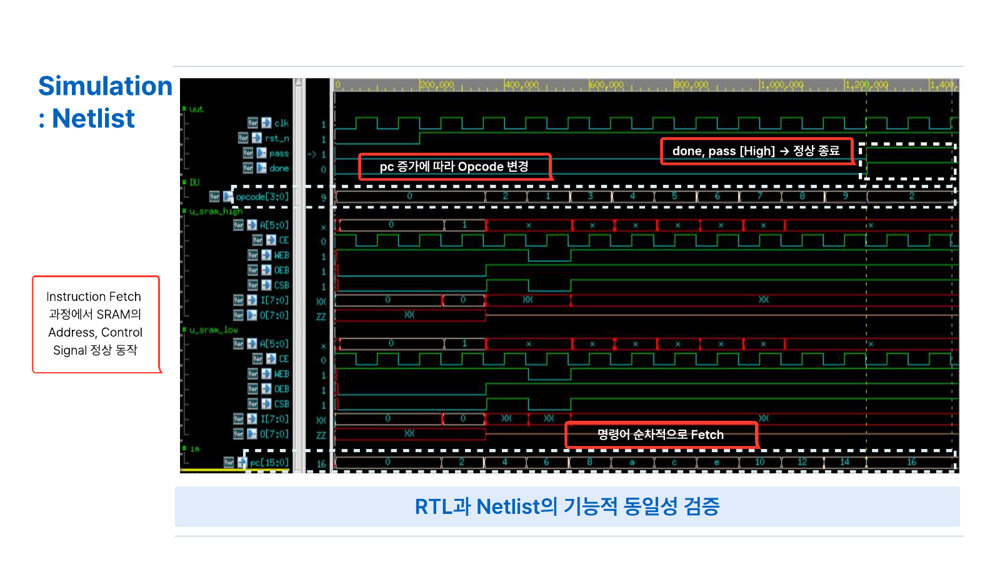

합성 netlist로 시뮬레이션한 결과가 RTL과 동일하게 동작해, **RTL과 netlist의 기능적 동일성**을 확인했습니다.

---

### Slide 27 · Report QoR — TSMC 130nm

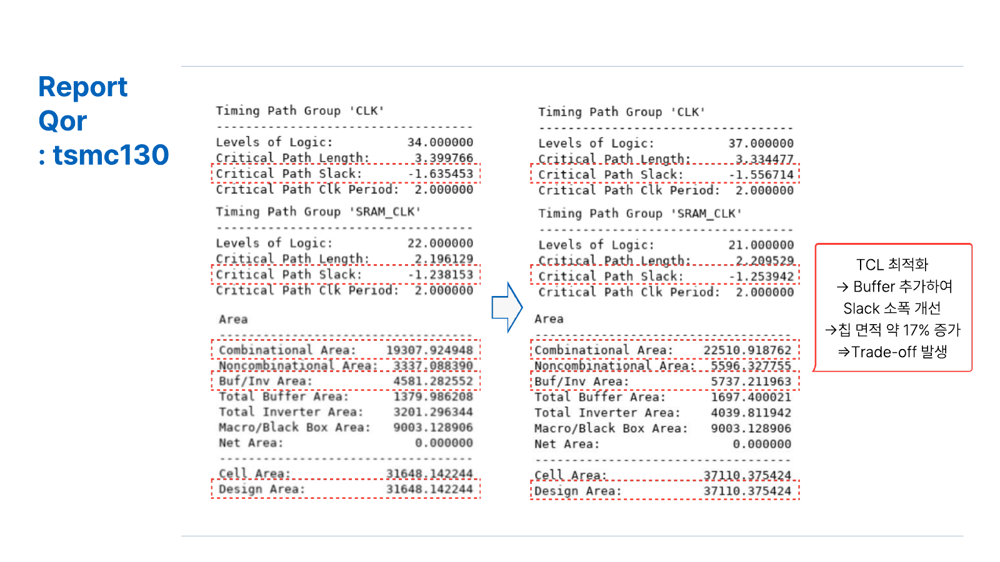

TCL 최적화(buffer 추가)로 CLK slack −1.635 → −1.557로 소폭 개선, 칩 면적은 약 **17% 증가** → Timing-Area trade-off

---

### Slide 28 · Report QoR — TSMC 180nm

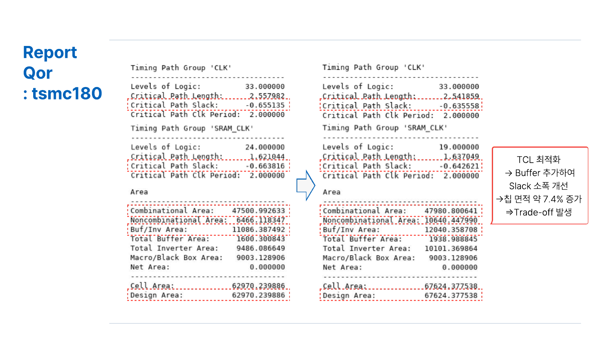

CLK slack −0.655 → −0.636, SRAM_CLK −0.664 → −0.643으로 소폭 개선, 면적은 약 **7.4% 증가**

---

### Slide 29 · Process Scaling — 32 / 130 / 180nm

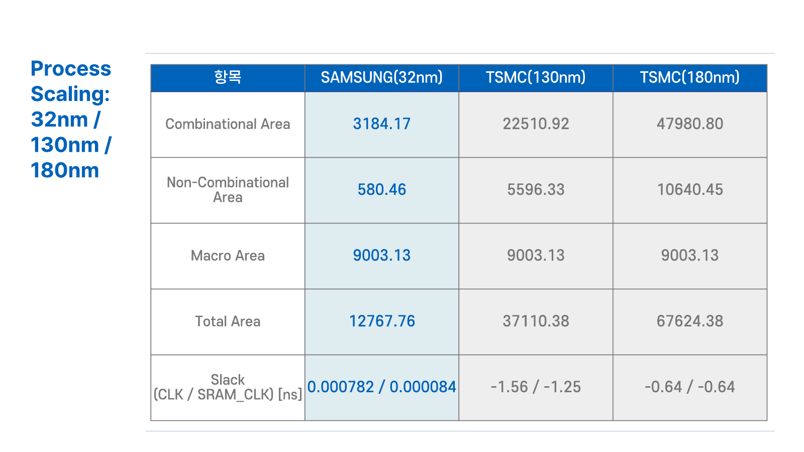

| 항목 | 32nm | TSMC 130nm | TSMC 180nm |
|---|---:|---:|---:|
| Combinational Area | **3184.17** | 22510.92 | 47980.80 |
| Non-Combinational Area | **580.46** | 5596.33 | 10640.45 |
| Macro Area | 9003.13 | 9003.13 | 9003.13 |
| Total Area | **12767.76** | 37110.38 | 67624.38 |
| Slack (CLK / SRAM_CLK) | **+0.000782 / +0.000084** | −1.56 / −1.25 | −0.64 / −0.64 |

---

### Slide 30 · Standard Cell Analysis

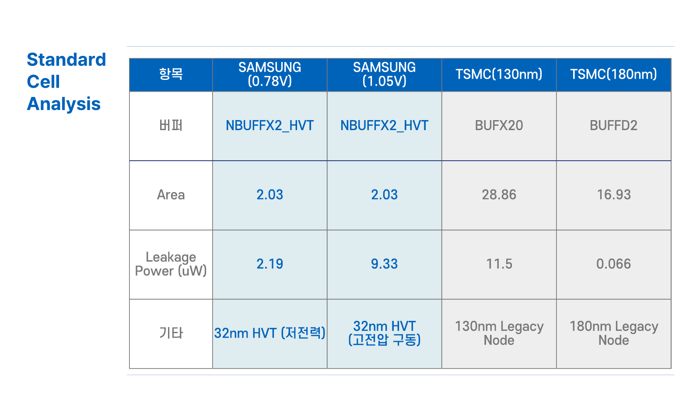

| | 32nm (0.78 V) | 32nm (1.05 V) | TSMC 130nm | TSMC 180nm |
|---|---|---|---|---|
| Buffer | NBUFFX2_HVT | NBUFFX2_HVT | BUFX20 | BUFFD2 |
| Area | 2.03 | 2.03 | 28.86 | 16.93 |
| Leakage (uW) | 2.19 | 9.33 | 11.5 | 0.066 |

---

### Slide 31 · Process Scaling — 공정별 특성

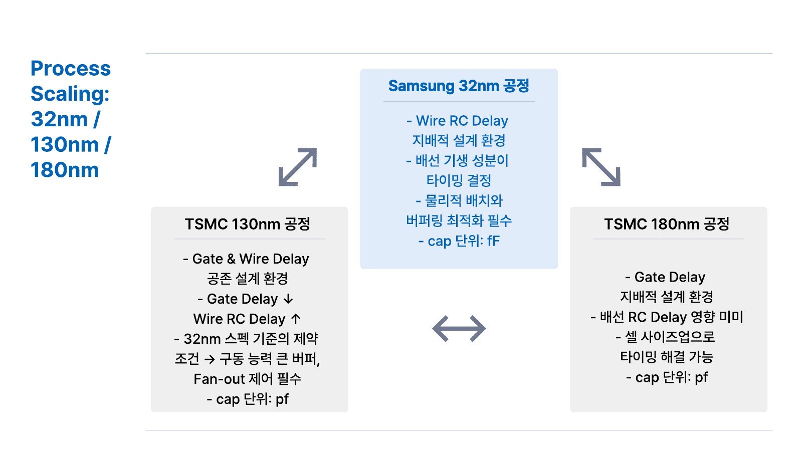

- **32nm**: Wire RC delay가 지배적 → 물리적 배치와 버퍼링 최적화 필수 (cap 단위 fF)
- **130nm**: Gate와 Wire delay 공존 → 구동 능력 큰 버퍼, fan-out 제어 필요 (cap 단위 pF)
- **180nm**: Gate delay 지배적 → 셀 사이즈업으로 timing 해결 가능 (cap 단위 pF)

---

### Slide 32 · Front-end Closing

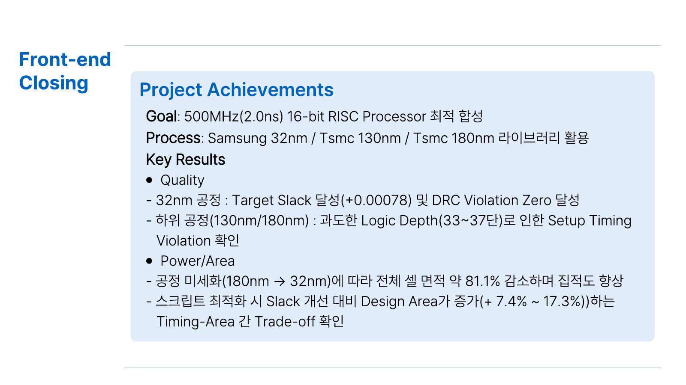

- **Quality**: 32nm에서 target slack(+0.00078) 달성, DRC 위반 0 · 130 / 180nm는 logic depth(33 ~ 37단)로 setup 위반 확인
- **Power / Area**: 180nm → 32nm에서 셀 면적 약 **81.1% 감소** · 스크립트 최적화 시 slack 개선 대비 면적 증가(+7.4% ~ 17.3%) → Timing-Area trade-off

---

## 2. Back-end

### Slide 33 · Floorplan — TCL

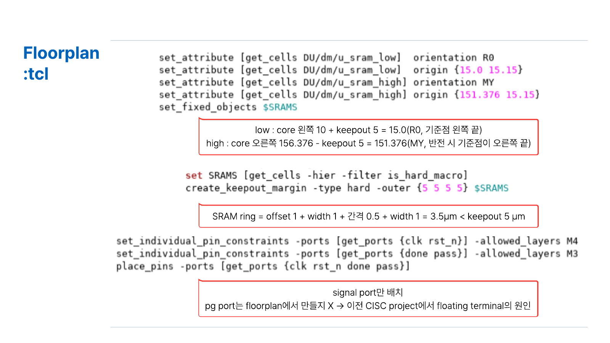

```tcl
set_attribute [get_cells DU/dm/u_sram_low]  orientation R0
set_attribute [get_cells DU/dm/u_sram_low]  origin {15.0 15.15}     ;# core 왼쪽 10 + keepout 5
set_attribute [get_cells DU/dm/u_sram_high] orientation MY
set_attribute [get_cells DU/dm/u_sram_high] origin {151.376 15.15}  ;# core 오른쪽 156.376 − keepout 5
create_keepout_margin -type hard -outer {5 5 5 5} $SRAMS
```

SRAM ring 총폭 = offset 1 + width 1 + 간격 0.5 + width 1 = **3.5 µm < keepout 5 µm**.
pin은 signal port만 배치했습니다. (이전 프로젝트에서 floorplan 단계에 PG port를 만들지 않은 것이 floating terminal의 원인이었음)

---

### Slide 34 · Floorplan — 결과

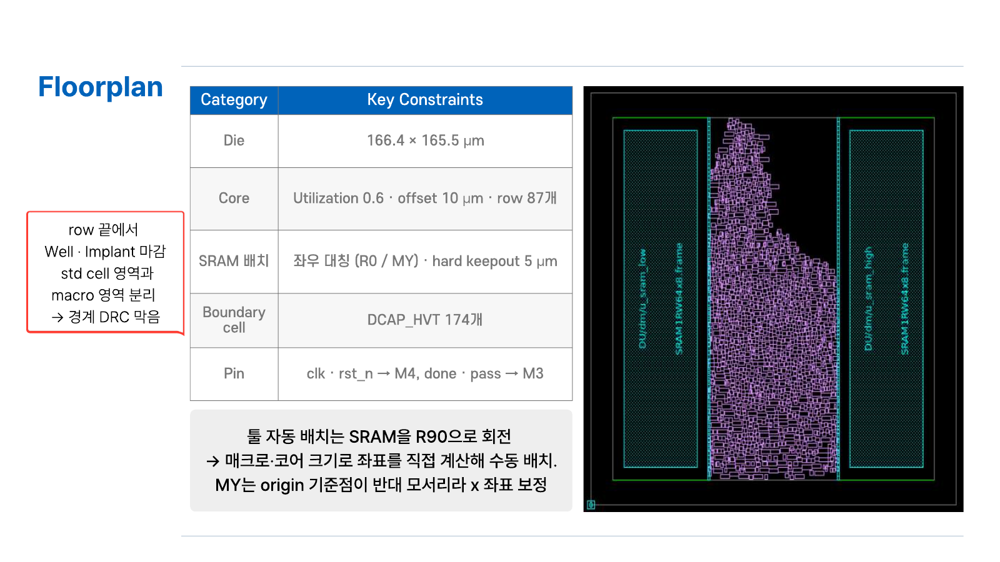

| Category | Key Constraints |
|---|---|
| Die | 166.4 × 165.5 µm |
| Core | Utilization 0.6 · offset 10 µm · row 87개 |
| SRAM 배치 | 좌우 대칭 (R0 / MY) · hard keepout 5 µm |
| Boundary cell | DCAP_HVT 174개 (row 끝 well · implant 마감) |
| Pin | clk · rst_n → M4, done · pass → M3 |

> 💡 툴 자동 배치는 SRAM을 R90으로 회전시켜서, 매크로와 코어 크기로 **좌표를 직접 계산해 수동 배치**했습니다. MY는 origin 기준점이 반대 모서리라 x 좌표를 보정했습니다.

---

### Slide 35 · Powerplan — TCL

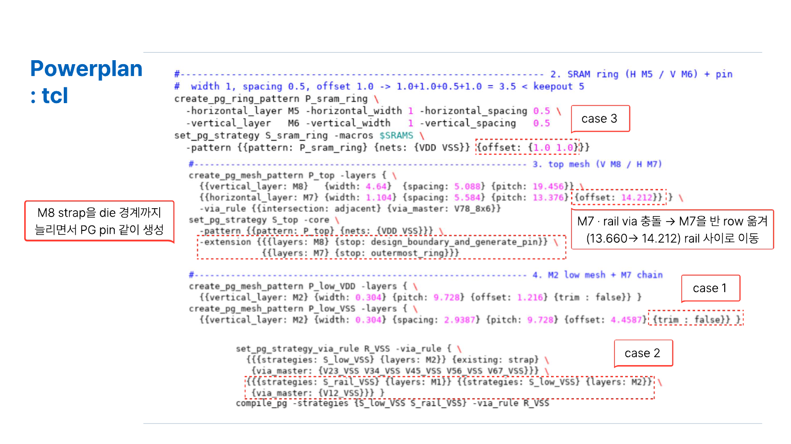

SRAM ring(H M5 / V M6) + SRAM pin 연결, top mesh(V M8 / H M7), M2 low mesh + M7 chain 순서로 구성했습니다. M8 strap은 die 경계까지 늘려 PG pin을 함께 생성했고, M7은 rail via와 충돌해서 반 row 옮겨(offset 13.660 → **14.212**) rail 사이로 이동했습니다.

---

### Slide 36 · Powerplan — 결과

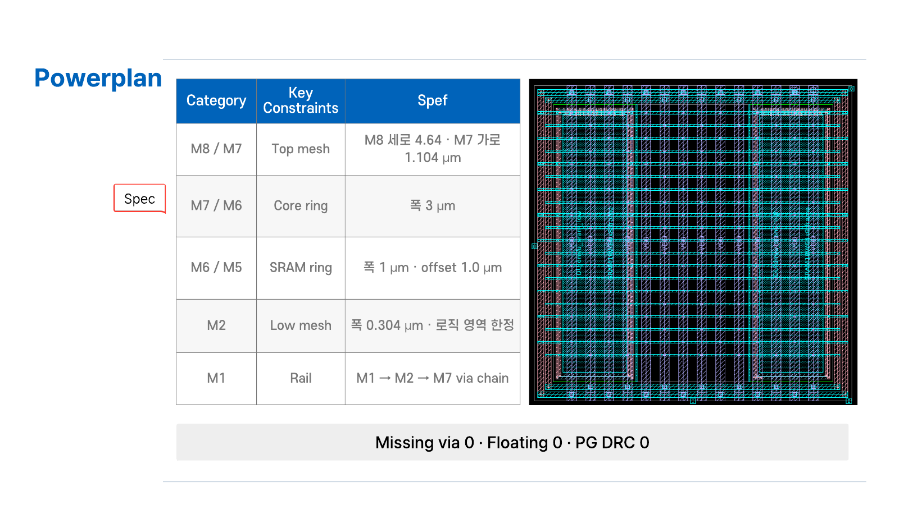

| Layer | 구성 | Spec |
|---|---|---|
| M8 / M7 | Top mesh | M8 세로 4.64 · M7 가로 1.104 µm |
| M7 / M6 | Core ring | 폭 3 µm |
| M6 / M5 | SRAM ring | 폭 1 µm · offset 1.0 µm |
| M2 | Low mesh | 폭 0.304 µm · 로직 영역 한정 |
| M1 | Rail | M1 → M2 → M7 via chain |

✅ **Missing via 0 · Floating 0 · PG DRC 0**

---

### Slide 37 · Powerplan — case 1: rail floating

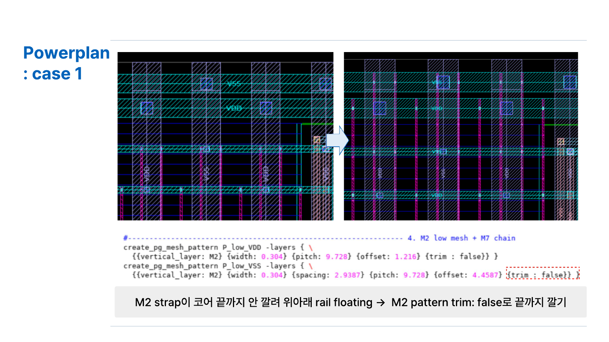

> ⚠️ M2 strap이 코어 끝까지 깔리지 않아 위아래 rail이 floating
> ✅ M2 pattern을 `trim : false`로 바꿔 끝까지 깔아서 해결

---

### Slide 38 · Powerplan — case 2: rail via 대상

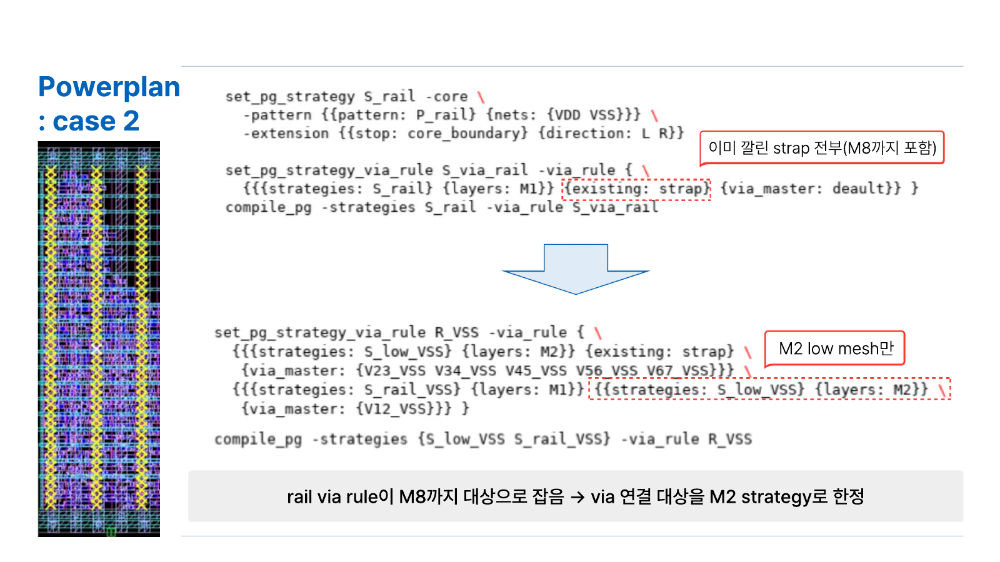

> ⚠️ rail via rule이 `existing: strap`으로 M8까지 이미 깔린 strap 전부를 대상으로 잡음
> ✅ via 연결 대상을 **M2 low mesh strategy로 한정**해서 해결

---

### Slide 39 · Powerplan — case 3: SRAM ring 잘림

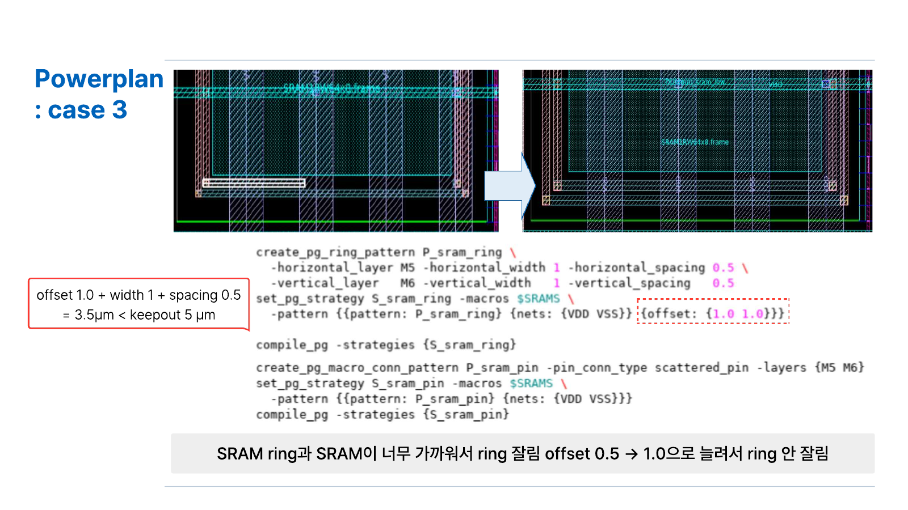

> ⚠️ SRAM ring과 SRAM이 너무 가까워 ring이 잘림
> ✅ offset 0.5 → **1.0**으로 늘려 해결 (총폭 3.5 µm < keepout 5 µm 유지)

---

### Slide 40 · Placement — TCL

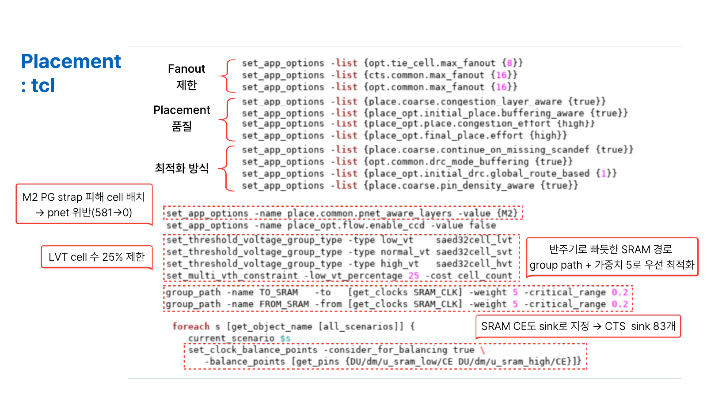

- Fanout 제한, congestion / buffering aware placement, effort high
- `place.common.pnet_aware_layers M2` — M2 PG strap을 피해 셀 배치 → **pnet 위반 581 → 0**
- `set_multi_vth_constraint -low_vt_percentage 25 -cost cell_count` — **LVT 25% 제한**
- `group_path TO_SRAM / FROM_SRAM -weight 5` — 반주기로 빠듯한 SRAM 경로 우선 최적화
- SRAM CE를 clock balance point로 지정 → CTS sink 83개

---

### Slide 41 · Placement — SRAM 경로 분석

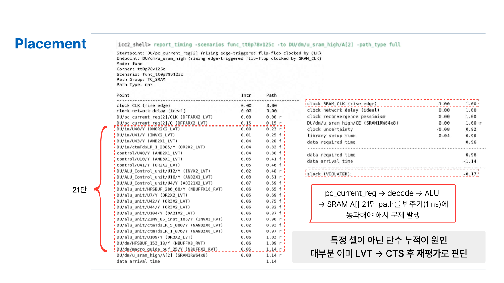

`pc_current_reg → decode → ALU → SRAM A[]`까지 **21단** 경로가 반주기(1 ns) 안에 도착해야 해서 slack **−0.17 ns**.
특정 셀이 아닌 단수 누적이 원인이고 경로 대부분이 이미 LVT라서, **CTS 후 재평가**하기로 판단했습니다.

---

### Slide 42 · Placement — 결과

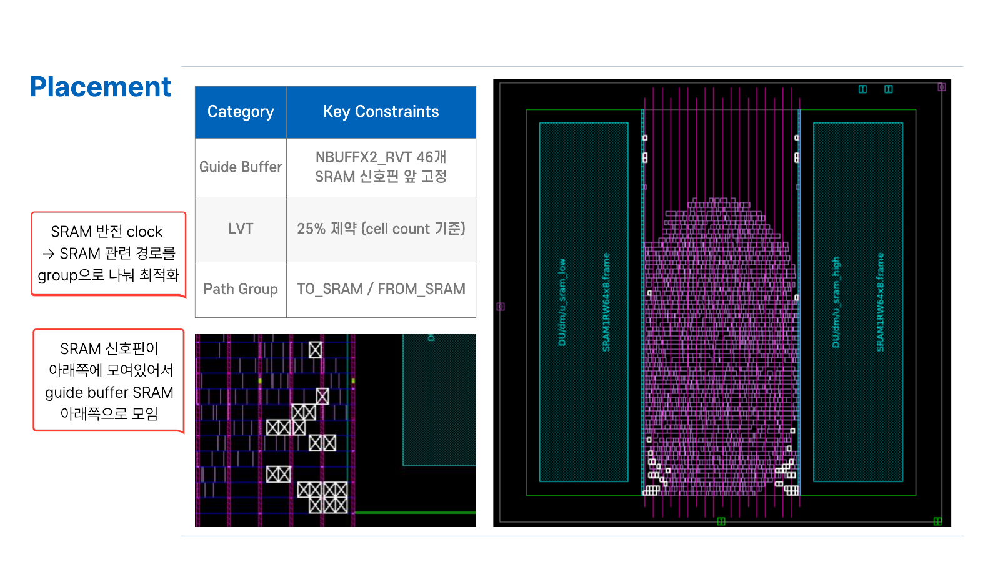

| Category | Key Constraints |
|---|---|
| Guide Buffer | NBUFFX2_RVT 46개, SRAM 신호핀 앞 고정 |
| LVT | 25% 제약 (cell count 기준) |
| Path Group | TO_SRAM / FROM_SRAM |

SRAM 신호핀이 아래쪽에 모여 있어서 guide buffer도 SRAM 아래쪽에 배치되었습니다.

---

### Slide 43 · CTS — TCL

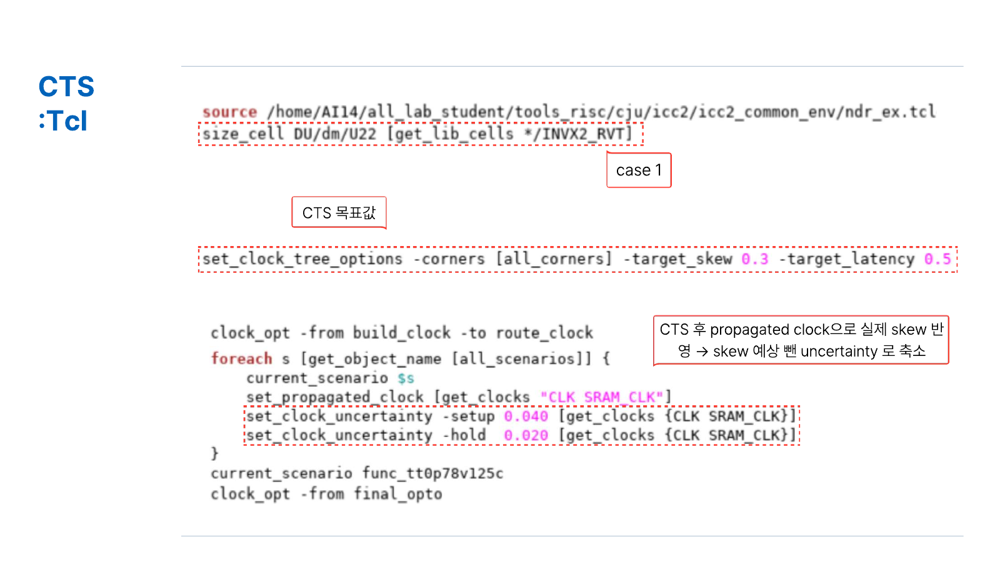

```tcl
size_cell DU/dm/U22 [get_lib_cells */INVX2_RVT]                         ;# case 1
set_clock_tree_options -corners [all_corners] -target_skew 0.3 -target_latency 0.5
clock_opt -from build_clock -to route_clock
set_propagated_clock [get_clocks "CLK SRAM_CLK"]
set_clock_uncertainty -setup 0.040 [get_clocks {CLK SRAM_CLK}]          ;# skew 예상분 제외
set_clock_uncertainty -hold  0.020 [get_clocks {CLK SRAM_CLK}]
clock_opt -from final_opto
```

---

### Slide 44 · NDR

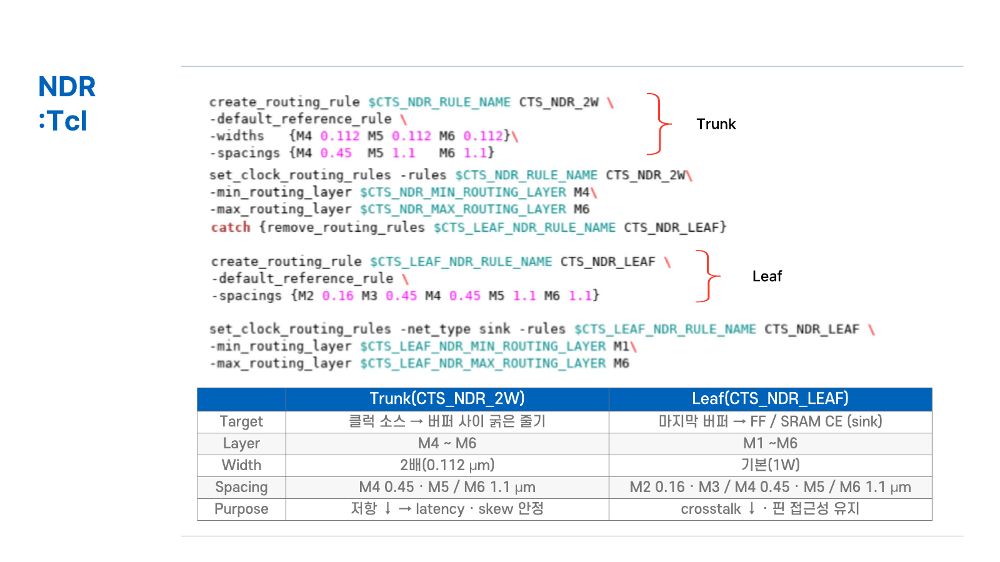

| | Trunk (CTS_NDR_2W) | Leaf (CTS_NDR_LEAF) |
|---|---|---|
| Target | 클럭 소스 → 버퍼 사이 굵은 줄기 | 마지막 버퍼 → FF / SRAM CE (sink) |
| Layer | M4 ~ M6 | M1 ~ M6 |
| Width | 2배 (0.112 µm) | 기본 (1W) |
| Spacing | M4 0.45 · M5 / M6 1.1 µm | M2 0.16 · M3 / M4 0.45 · M5 / M6 1.1 µm |
| Purpose | 저항 ↓ → latency · skew 안정 | crosstalk ↓ · 핀 접근성 유지 |

---

### Slide 45 · CTS — 결과

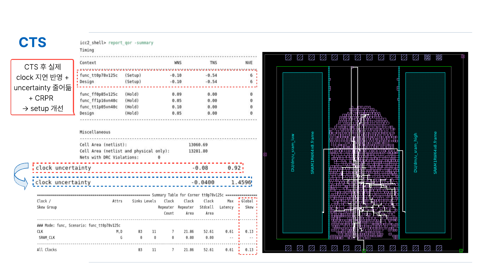

- Sink 83 · Levels 11 · Repeater 7 · Max latency 0.61 · **Global skew 0.13 ns** (목표 0.3)
- 실제 clock 지연 반영 + uncertainty 0.08 → 0.04 + CRPR로 setup 개선 (WNS −0.10 / NVE 6)
- Hold는 4코너 모두 위반 0

---

### Slide 46 · CTS — case 1: CTS-903

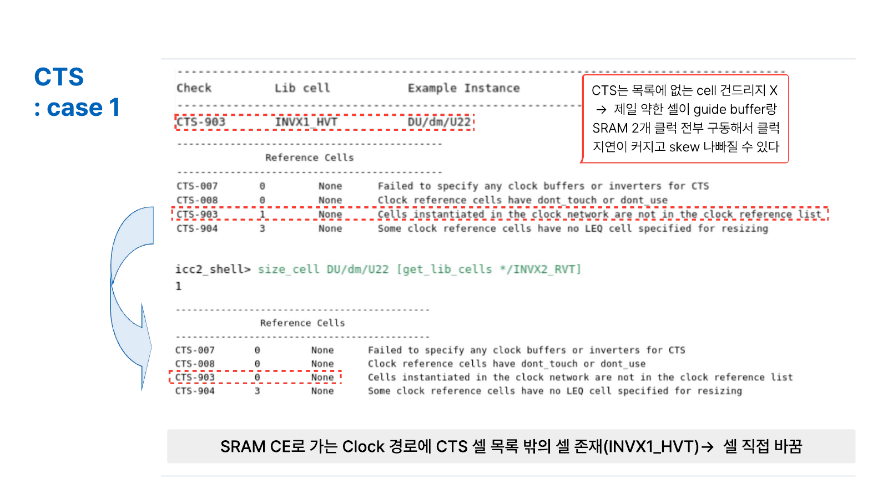

> ⚠️ **CTS-903** — SRAM CE로 가는 clock 경로에 CTS 셀 목록에 없는 `INVX1_HVT`(DU/dm/U22)가 있었습니다. CTS는 목록에 없는 셀을 건드리지 않아서, 가장 약한 셀이 guide buffer와 SRAM 2개의 클럭을 전부 구동해 latency와 skew가 나빠질 수 있었습니다.
> ✅ `size_cell DU/dm/U22 INVX2_RVT`로 직접 교체 → CTS-903 **0**

---

### Slide 47 · Route — TCL

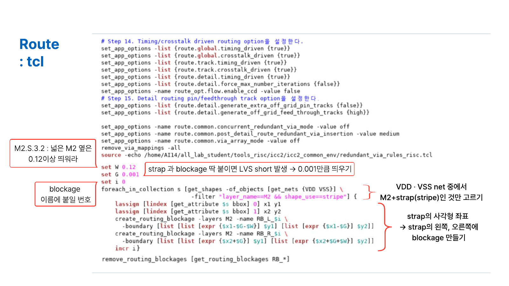

timing / crosstalk driven routing, post-route redundant via(medium)를 설정했습니다.
**M2.S.3.2**(넓은 M2 옆은 0.12 이상 띄워라) 대응으로 VDD / VSS M2 strap 좌우에 routing blockage를 만드는 스크립트를 작성했습니다. strap과 blockage를 딱 붙이면 LVS short가 나서 **0.001 µm**만큼 띄웠습니다.

---

### Slide 48 · Route — 결과

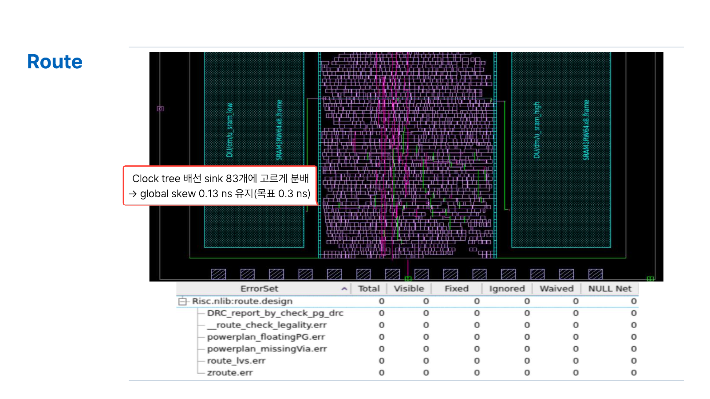

Clock tree 배선이 sink 83개에 고르게 분배되어 **global skew 0.13 ns** 유지(목표 0.3 ns).
`check_pg_drc`, legality, floating PG, missing via, LVS, zroute 오류 **모두 0**.

---

### Slide 49 · Route — case 1: Clock NDR spacing

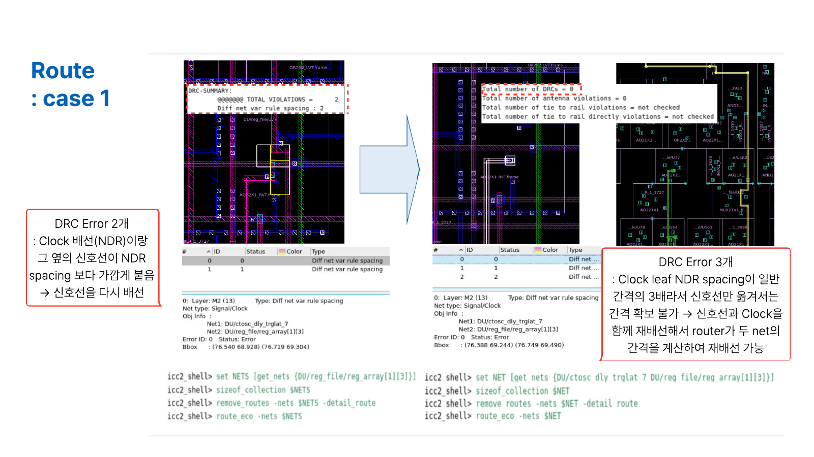

> ⚠️ DRC 2건 — clock 배선(NDR) 옆 신호선이 NDR spacing보다 가깝게 붙음. 신호선만 다시 배선하자 3건으로 늘어남
> ✅ clock leaf NDR spacing이 일반 간격의 3배라 신호선만 옮겨서는 간격 확보가 안 됨 → **신호선과 clock을 함께** `remove_routes` + `route_eco`로 재배선해 router가 두 net의 간격을 같이 계산하게 함 → **DRC 0**

---

### Slide 50 · Route — case 2: max transition

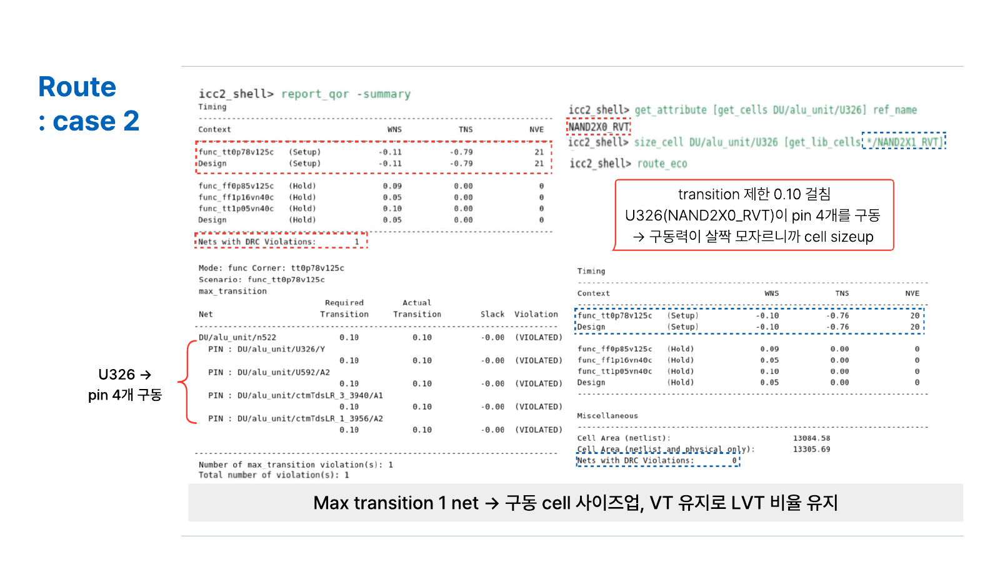

> ⚠️ `alu_unit/U326`(NAND2X0_RVT)이 pin 4개를 구동해 max_transition 0.10 제한에 걸림
> ✅ **NAND2X1_RVT로 size up**, VT는 유지해서 LVT 비율 유지 → DRC nets 0

---

### Slide 51 · Filler


- SHFILL HVT 5종으로 **filler 3712개** 삽입 — row마다 well · implant · power rail 연속성 확보
- `connect_pg_net`, `write_def`, `write_parasitics`로 최종 출력

---

## 3. Signoff & Verification

### Slide 52 · ICV — TCL


| 옵션 | 의도 |
|---|---|
| `check_drc.ignore_child_cell_errors false` | Cell · SRAM 내부 위반도 모두 보고 |
| `check_drc.fill_view_data discard` | metal fill은 검사에서 제외 |
| `physical.merge_stream_files $ICV_MERGE_GDS` | Cell frame 대신 **실제 cell GDS**로 검사 |
| `signoff_check_drc -check_all_runset_layers true` | 배선층 + implant · well 같은 base layer까지 검사 |

---

### Slide 53 · ICV — case 1: M2.S.3.2 (171건)


> ⚠️ PG strap 옆 신호선 간격 규칙을 ICC2가 반영하지 않아 **M2.S.3.2 171건**. strap 옆 신호선이 0.098 µm로 붙어 있었습니다.
> ✅ 위반 구간에만 routing blockage를 만들고 net을 재배선, 핀 때문에 못 비키는 net은 배선을 직접 이동 → **171 → 0**

---

### Slide 54 · Trade-off — runset 분석


runset 코드를 직접 읽어 규칙을 확인했습니다.

- `m2_w_03`: 폭 0.3 ~ 1.5 µm M2를 "넓은 M2"로 정의 → PG strap(0.304 µm)이 여기에 해당
- **M2.S.3.2**: 넓은 M2 옆을 다른 M2가 0.3 µm 이상 나란히 지나가면 간격 0.12 µm 이상 필요. 설명 문구는 0.11이지만 **실제 검사 코드는 < 0.12**라서 strap 옆 0.098 µm 신호선이 걸림
- **`m2_s_01` (M2.S.6)**: 폭 0.1 ~ 0.3 µm M2끼리 0.2 µm 넘게 나란히 달리면 간격 0.12 µm 이상 필요

> 🔍 strap을 0.28 µm로 줄여 넓은 M2 규칙을 피하려 했지만, 이번엔 M2.S.6 구간에 들어가 via pad 등과 걸려 **836건** 발생 → **0.304 µm 유지 + 국소 수정**이 최적이라고 판단했습니다.

---

### Slide 55 · ICV — case 2: M1 spacing / width


> ⚠️ M1.S.9(17건), M1.W.2.1(36건) — 같은 net의 M2 배선과 via pad 사이 0.012 µm 틈을 ICV가 별개의 금속으로 인식
> ✅ `create_shape`로 **M2 조각을 이어 붙이고**, spacing error는 bar via를 사각 via(1 cut)로 교체 + 재배치

ICC2는 셀을 pin과 외곽만 있는 frame으로 보고, ICV는 셀 내부까지 그려진 실제 GDS로 검사합니다. 그래서 cell pin과 via 사이 간격 문제는 ICV에서만 드러났습니다.

---

### Slide 56 · ICV — case 3: Implant spacing


> ⚠️ NIMP.S.1 / PIMP.S.1 — implant 영역 간격이 0.102 µm 규칙(딱 붙이거나 0.102 µm 이상)에 걸림. 셀 경계 안쪽 implant가 0.05 µm 어긋남
> ✅ 필러 한 칸으로는 해결되지 않아 **굵은 필러**로 간격을 넓혀 해결 (셀 VT 변경 없음 → timing 영향 0)

---

### Slide 57 · PT ECO


setup 경로의 셀이 거의 LVT인데 LVT 전체가 dont_use로 막혀 있어 크기를 키울 수 없었습니다 → LVT 제한을 풀고 `fix_eco_timing -methods size_cell` 적용.

| Cell | Change | Reason |
|---|---|---|
| guide_buf_34 | X2_RVT → X4_RVT | transition |
| guide_buf_11 | X2_RVT → X4_RVT | transition |
| guide_buf_24 | X2_RVT → X2_LVT | setup |

SRAM_high A[1] 경로 slack **−0.00 → +0.016**. buffer를 추가하지 않고 size만 바꿔 레이아웃 변경을 최소화했고, ICC2 재적용 후 ICV 재검증 범위도 줄였습니다.

---

### Slide 58 · Signoff DRC


| Rule | Initial | Final | Action |
|---|---:|---:|---|
| M2.S.3.2 | 171 | **0** | 국소 blockage · 배선 이동 |
| M1.S.1 · M1.S.9 | 29 | **0** | via 교체 · 재배치 · M2 patch |
| M1.W.2.1 | 36 | 30 (**Detailed 0**) | Detailed 수정, 나머지는 셀 핀 · SRAM 자체 형상 → waiver |
| NIMP · PIMP · LVTIMP | 3 | **0** | 굵은 filler로 간격 확보 |
| M3.S.2 | 3 | **0** | 해당 net 재배선 |
| VIA1.S.2 | 3 | **0** | 작업 중 발생, 해당 net 재배선 |
| VIA3.B.1 | 96 | 96 | 전부 SRAM 내부 → waiver |

초기 약 **340건 → Detailed 위반 0**, 잔여 126건(M1.W.2.1 30 + VIA3.B.1 96)은 waiver 항목입니다.

---

### Slide 59 · STA Signoff


| Category | Before ECO | After ECO (Final) |
|---|---|---|
| Setup · tt0p78v125c | −0.0017 ns (SRAM_high A[1]) | **MET (+0.0008 ns)** |
| Max transition | 2 (SRAM I[6] 0.1007 / 0.1004) | **0** |
| Max capacitance | 1 (32.04 / 32 fF) | 1 · 잔여 (0.13%) |
| Hold · 4코너 | 0 | **0** |
| LVT | 380 | 381 (**24.4%**) |

Flow: **PT ECO**(size_cell 3) → **ICC2 적용**(legalize · route_eco) → **ICV** 재검증 → **StarRC** SPEF 재추출 → **PT 재확인**(violation 0)

---

### Slide 60 · Correlation — ICC2 vs PT


- ICC2 내부 추출(TLU+ 추정 RC) 기준 setup **−0.13 ns** → 실제보다 마진을 크게 잡은 PnR 단계 추정값
- StarRC SPEF · CRPR · 4코너 DMSA 기준 PT에서는 setup / hold **Violated 0**
- Untested 항목은 상수로 고정된 SRAM 주소 핀, 제약 없는 비동기 reset → timing 위반과 무관

---

### Slide 61 · Correlation — 최종 판정 기준


| ICC2 내부 추출 | PrimeTime Signoff |
|---|---|
| **−0.13 ns** | **+0.0008 ns (MET)** |
| TLU+ 모델로 배선 RC 추정, 배치 · 배선 반복용 보수적 지표 | StarRC가 실제 형상으로 추출한 SPEF, CRPR · 4코너 DMSA, **최종 판정 기준** |

SRAM 반주기 구조 특성상 setup은 1 ns 안에서 빠듯하지만, hold는 반 주기만큼 여유가 있습니다.

---

### Slide 62 · Formality — DC ↔ PnR


| Compare Point | Count |
|---|---:|
| DFF | 81 |
| SRAM 입력 핀 (18 × 2) | 36 |
| 출력 port (done, pass) | 2 |
| **합계 · Failing** | **119 · 0** |

**RTL ↔ DC SUCCEEDED**, **DC ↔ PnR SUCCEEDED**

---

### Slide 63 · Simulation — PnR Netlist


최종 PnR netlist에서도 Opcode 순서와 SRAM 신호가 RTL과 같았습니다. `pc_current[0]`은 항상 0이라 합성 최적화로 제거되어, `[15:1]` 표시값은 PC / 2입니다. → **Netlist와 PnR의 기능적 동일성 확인**

---

## 4. Overview

### Slide 64 · 설계 사양 · MCMM


| Category | Key Constraints |
|---|---|
| TOP / 구성 | Risc_16_bit · Control Unit, Datapath, ALU, GPR, Instruction Memory, Data Memory |
| Macro | SRAM1RW64x8 × 2 (Data Memory 하위 / 상위 8비트) |
| Library | SAED 32nm std cell (HVT · RVT · LVT) + SRAM |
| Goal | LVT ≤ 25% · CTS skew 0.3 / latency 0.5 ns · DRC / LVS 0 |

| Scenario | Voltage | Temp | RC | Analysis |
|---|---|---|---|---|
| func_tt0p78v125c | 0.78 V | 125 °C | Cmax | Setup |
| func_tt1p05vn40c | 1.05 V | −40 °C | Cmin | Hold |
| func_ff0p85v125c | 0.85 V | 125 °C | Cmax | Hold |
| func_ff1p16vn40c | 1.16 V | −40 °C | Cmin | Hold |

Hold는 cell과 배선 비중에 따라 worst 코너가 경로마다 달라서 빠른 조건 3개에서 모두 확인했습니다.

---

### Slide 65 · 설계 흐름


- **PnR**: Floorplan(SRAM 배치) → Powerplan(M1 ~ M8 계층형 PG) → Placement(guide buffer) → CTS(NDR) → Route(DRC 0) → Chip Finish(Filler)
- **Signoff**: ICV DRC(실제 GDS) → StarRC(SPEF) → PrimeTime(DMSA 4코너) → PT ECO(size_cell)
- **Closure**: ICC2 ECO 반영(route_eco) → ICV · StarRC · PT 재확인(violation 0) → Formality(DC ↔ PnR) → Gate Sim

---

### Slide 66 · 최종 결과


| 지표 | 결과 |
|---|---|
| Setup / Hold 위반 | **0** (PT signoff 4코너, StarRC SPEF) |
| ICV Detailed 위반 | **0** (초기 340건대, 잔여는 waiver) |
| LVS | **0** (Short · Open · Antenna 0) |
| Formality | **119** points SUCCEEDED (DC ↔ PnR) |
| CTS skew | **0.13 ns** (목표 0.3 ns, sink 83) |
| PT ECO | **3** cells (크기 / VT만 변경, buffer 추가 없음) |
| Gate-level Sim | **PASS** |

잔여: Max capacitance 1건 (0.13% 초과)

---

### Slide 67 · Closing


**Timing**
- PT signoff 4코너(MCMM) 기준 Setup / Hold 위반 0 (PT ECO 셀 3개, buffer 추가 없이 size만 변경)
- SRAM 반전 클럭으로 반주기(1 ns) 경로가 critical: logic depth 21단 → Placement −0.17 ns → CTS −0.10 ns → **Signoff MET**

**Quality (Signoff)**
- **ICC2 Clean ≠ ICV Clean** — frame과 실제 GDS의 차이로 생긴 M1 / M2 / implant 위반의 원인을 분석해 수정
- LVS · Antenna 0, Formality 119 points equivalent

**Power / Area**
- LVT 24.4%(제약 25% 이내)로 leakage를 관리하면서 timing 확보
- M2 PG strap 폭 trade-off: 0.28 µm로 줄이면 M2.S.6 위반 836건 → **0.304 µm 유지가 최적**
- 잔여 max capacitance 1건은 PnR max_fanout 16 설정이 원인으로, DC와 같은 8을 적용하면 예방 가능

---

[← 메인으로](../README.md)
