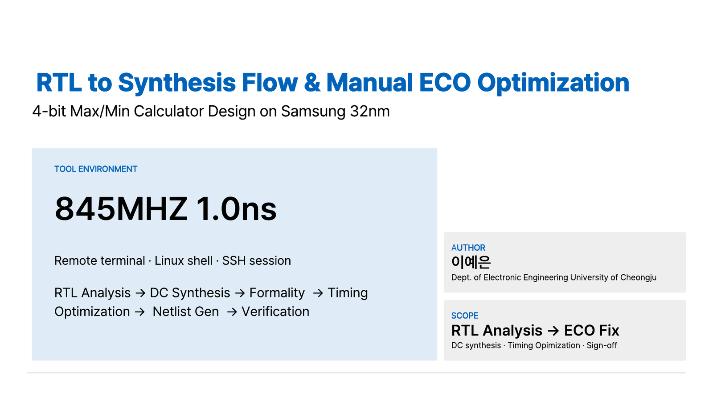

# 이예은 | Digital IC Design Portfolio

> RTL 합성 → Manual ECO → Physical Design(RTL-to-GDSII) → Sign-off 검증까지 직접 수행한 프로젝트를
> **발표 자료(PPT) 페이지 순서대로** 정리한 포트폴리오입니다.

📧 your.email@example.com

---

## 📂 Sessions

| # | Session | 기간 | 주요 내용 |
|:---:|---|---|---|
| 1 | [**TOP Design Project**](./01_TOP/README.md) | 2026.10 | 4-bit Max/Min 연산기 · DC 합성 + **Manual ECO** · Formality · **ICC2 RTL-to-GDSII** · Setup/Hold/DRC/LVS **0** |

<table>
<tr>
<td align="center" width="33%"> <b>Session 1 · TOP</b></td>
</tr>
</table>

---

## 🛠 Tools

`Synopsys VCS` · `Design Compiler` · `Formality` · `IC Compiler II` · `Tcl`
Library: SAED 32nm (HVT / RVT / LVT), TSMC 180nm (공정 비교)
